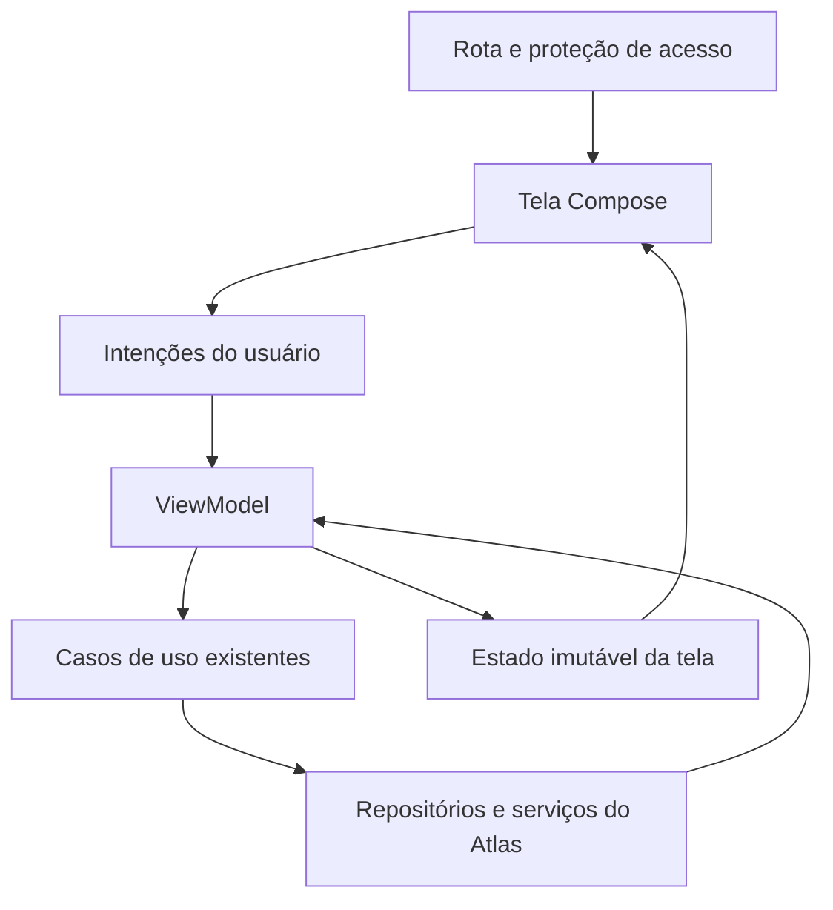
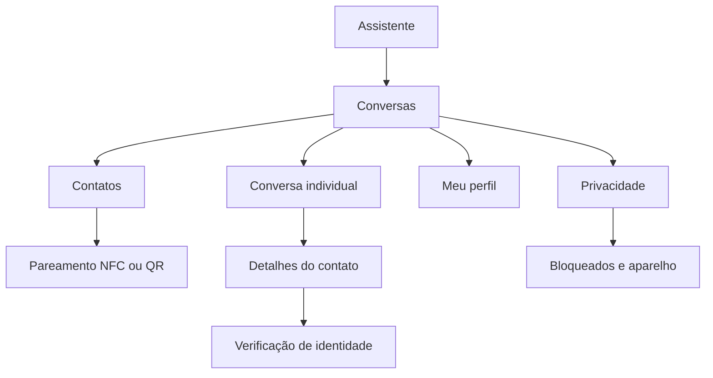

# ATLAS CHAT — Plano de arquitetura, layouts e telas

**Responsável:** Marco Aurélio da Cunha Prudente
**Data:** 16 de outubro de 2026
**Versão:** 1.0
**Objetivo:** orientar a criação das telas e sua integração com os recursos já desenvolvidos no Atlas.
**Status:** plano de implementação; código atual e funcionalidades implantadas ainda não inspecionados.

## 1. Direção do trabalho

Criar primeiro um prototipo navegável em Jetpack Compose, usando os mesmos componentes que serão conectados aos serviços reais. O primeiro conjunto deve conter: tela atual do assistente com acesso ao chat, lista de conversas e conversa aberta. Depois completar contatos, pareamento, perfil e segurança.

O usuário informou que já implantou muitos recursos. Portanto, este plano não pressupõe que os serviços existentes precisem ser reconstruídos. A primeira etapa é mapear o que existe e adaptar contratos, preservando as implementações corretas.

A referência visual disponível na conversa possui fundo escuro, destaque azul-lilás, cabeçalho "Atlas", menu lateral, menu de três pontos e campo "Pergunte ao Atlas...". A aparência proposta parte dessa referência; a tela atual do aplicativo pode ter evoluído.

### Escopo

- Arquitetura de apresentação e organização de arquivos.
- Inventário de telas, rotas e componentes.
- Estados de UI, comportamento e interação.
- Perfil, avatar, busca, respostas e silenciamento.
- Integração com dados, voz, privacidade e segurança.
- Backlog, validação e entrega incremental.

Não inclui código pronto, mockups rasterizados ou implantação realizada. Recursos futuros como grupos, arquivos e chamadas não devem aparecer como botões funcionais se não estiverem implementados.

## 2. Inventário inicial obrigatório

Antes de alterar o projeto, preencher a matriz abaixo a partir do código e de testes no aparelho. Não confundir tela existente com fluxo concluído.

| Área | Situação a registrar | Evidência necessária |
| --- | --- | --- |
| Conta Atlas | Existente / parcial / ausente | Login e identificação da conta |
| Aparelho autorizado | Existente / parcial / ausente | Registro e revogação |
| Contatos | Existente / parcial / ausente | Criar, aceitar, remover e bloquear |
| NFC / QR Code | Existente / parcial / ausente | Pareamento entre dois aparelhos |
| Sessões E2EE | Existente / parcial / ausente | Envio e recebimento após reinício |
| Mensagens e filas | Existente / parcial / ausente | Offline, retry e deduplicação |
| Histórico protegido | Existente / parcial / ausente | Leitura após desbloqueio |
| Perfil e avatar | Existente / parcial / ausente | Visibilidade e atualização |
| Notificações | Existente / parcial / ausente | Background e silenciamento |
| Voz e coletores | Existente / parcial / ausente | Pausa em superfície privada |
| Navegação e tema | Existente / parcial / ausente | Componentes reutilizáveis |

Registrar nome real dos módulos, APIs, ViewModels e repositórios existentes. Criar adaptadores quando necessário; não manter duas fontes de verdade para mensagens ou contatos.

## 3. Arquitetura de apresentação

Adotar fluxo unidirecional: a tela apresenta estado imutável e emite intenções; o ViewModel transforma dados em estado e delega operações aos serviços. Estado visual pequeno, como um menu aberto, pode ficar no componente ou no ancestral comum apropriado. Não levar toda interação visual ao backend.

### Responsabilidades

| Camada | Faz | Não faz |
| --- | --- | --- |
| Rota | Valida contexto, conecta ViewModel e callbacks de navegação | Transportar mensagens ou chaves nos argumentos |
| Tela | Layout, acessibilidade, foco e apresentação | Acessar Supabase diretamente |
| ViewModel | Estado, validações de interação e coordenação | Executar primitivas criptográficas próprias |
| Caso de uso | Enviar, buscar, bloquear e atualizar perfil | Decidir cor e dimensão de balão |
| Repositório | Fonte de dados e sincronização | Controlar componentes visuais |
| Serviços de segurança | Sessões, autorização e proteção | Depender de botão desabilitado como autorização |

Reutilizar sistema de injeção, navegação e tema existentes. Não fixar versões de bibliotecas sem verificar compatibilidade com o projeto.

## 4. Organização proposta de arquivos

Estes são caminhos relativos propostos dentro do projeto Android, não arquivos já criados:

| Diretório | Conteúdo |
| --- | --- |
| `feature/chat/navigation/` | Rotas, entrada no grafo e políticas de retorno |
| `feature/chat/conversations/` | Lista, ViewModel e estado |
| `feature/chat/conversation/` | Conversa individual, compositor e estado |
| `feature/chat/contacts/` | Lista e detalhes do contato |
| `feature/chat/pairing/` | NFC, QR e conferência de identidade |
| `feature/chat/profile/` | Perfil próprio e edição de avatar |
| `feature/chat/privacy/` | Privacidade, bloqueados e aparelho |
| `feature/chat/components/` | Componentes compartilhados |
| `feature/chat/model/` | Modelos exclusivamente visuais |
| `feature/chat/preview/` | Fixtures e cenários de demonstração |
| `core/designsystem/` | Tokens existentes ou novos do Atlas |

Separar cada pasta em módulo Gradle apenas quando houver benefício real. Para começar, pacotes dentro de um módulo podem ser suficientes. Evitar uma nova estrutura que duplique `chat-domain`, `chat-storage` ou serviços já implantados.

## 5. Mapa de telas e prioridade

| ID | Tela/superfície | Prioridade | Objetivo |
| --- | --- | --- | --- |
| T01 | Assistente com acesso ao chat | P0 | Entrar em Conversas |
| T02 | Lista de conversas | P0 | Encontrar e abrir conversas |
| T03 | Conversa individual | P0 | Ler, responder e enviar |
| T04 | Contatos / nova conversa | P1 | Escolher contato autorizado |
| T05 | Adicionar contato | P1 | Escolher NFC ou QR |
| T06 | Pareamento e verificação | P1 | Confirmar identidade bilateralmente |
| T07 | Detalhes do contato | P1 | Perfil, segurança e gerenciamento |
| T08 | Meu perfil no chat | P1 | Editar nome, avatar e recado |
| T09 | Edição de avatar | P1 | Selecionar e recortar foto |
| T10 | Privacidade do chat | P1 | Preferências e proteção local |
| T11 | Contatos bloqueados | P1 | Rever e desfazer bloqueios |
| T12 | Aparelho e identidade | P1 | Ver dispositivo e revogação |
| T13 | Busca na conversa | P2 | Encontrar mensagens locais |
| T14 | Desbloqueio / acesso necessário | P0 | Proteger entrada nas superfícies privadas |

P0 é a primeira entrega, não autorização para lançar sem as proteções obrigatórias. P1 completa os fluxos; P2 pode ser integrado depois do núcleo visual.

## 6. Navegação

### Rotas lógicas propostas

`ChatHome`, `ChatConversation(conversationId)`, `ChatContacts`, `ChatAddContact`, `ChatPairing(pairingId)`, `ChatContact(contactId)`, `ChatVerify(contactId)`, `ChatProfile`, `ChatAvatarEditor`, `ChatPrivacy`, `ChatBlockedContacts`, `ChatDevice` e `ChatSearch(conversationId)`.

Argumentos levam somente referências mínimas. Nunca passar texto, telefone, token de convite, segredo, bitmap ou objeto de sessão em URL, rota serializada ou log de navegação. Referências também não são autorização: revalidar conta e acesso ao carregar.

Voltar de uma conversa retorna à lista. Notificações passam por validação de conta e desbloqueio antes de abrir o destino. Troca de conta limpa a pilha do chat. Restauração de processo não pode reapresentar conteúdo privado antes de validar acesso.

## 7. Sistema visual

Manter identidade escura do Atlas e utilizar componentes Material compatíveis com o tema existente, personalizados por tokens.

| Token | Proposta inicial |
| --- | --- |
| Fundo | `#101216` |
| Superfície | `#24242C` |
| Superfície elevada | `#2D2F39` |
| Destaque | `#B1C4FF` |
| Texto principal | `#E5E7EE` |
| Texto secundário | `#B8BBC7` |
| Balão enviado | `#303B60` |
| Balão recebido | `#262831` |
| Margem principal | 16 dp |
| Escala de espaçamento | 4, 8, 12, 16, 24 e 32 dp |
| Área interativa | Pelo menos 48 dp |
| Avatar em lista | 48 dp |
| Avatar no cabeçalho | 40 dp |
| Cantos | 16–24 dp, conforme contexto |

Valores são ponto de partida. Validar contraste, fontes ampliadas e estados reais. Não afirmar conformidade de acessibilidade sem teste.

Preservar hierarquia: uma ação principal por superfície, texto legível, pouca ornamentação e separação por espaço. Em telas largas, limitar largura de leitura; uma apresentação em duas colunas pode ser evolução posterior, sem bloquear o MVP de telefone.

## 8. Especificação T01 — Entrada no assistente

Adicionar ícone de conversas antes dos três pontos, com área de toque confortável. Manter menu lateral, título, saudação, sugestões e campo atual.

Badge conta conversas não lidas; máximo visual `99+`. Descrição acessível informa a quantidade. Nenhum nome ou texto privado aparece nessa superfície.

Acesso alternativo no menu lateral: "Conversas". Ambos abrem o mesmo destino e não criam pilhas duplicadas.

**Aceite:** abrir o chat com um toque; voltar mantém o estado útil do assistente; entrar em chat aciona a política de pausa de voz antes de revelar conteúdo privado.

## 9. Especificação T02 — Lista de conversas

Cabeçalho: voltar, "Conversas", adicionar contato e menu. Busca local por nome. Lista com avatar, nome, horário do último evento visível, texto genérico e badge. Botão flutuante "Nova conversa".

Prévia padrão: "Nova mensagem", "Conversa privada", "Envio pendente" ou "Verificação necessária". Não mostrar texto da mensagem por padrão.

Ordenar por última mensagem visível. Recibos, atualizações de avatar e eventos de sincronização não sobem a conversa. Nomes longos podem ocupar limite definido, sem empurrar badge e horário para fora.

Estados: carregando, vazio, conteúdo, bloqueado, offline com conteúdo e erro sem conteúdo. Não substituir a lista inteira por um spinner quando uma atualização estiver em curso.

**Aceite:** lista utilizável offline com dados locais autorizados; vazio oferece adicionar por NFC/QR; atualização não provoca salto de rolagem desnecessário.

## 10. Especificação T03 — Conversa individual

### Cabeçalho

Voltar, avatar, nome e menu. Nome/avatar abrem detalhes. Não mostrar presença, visto por último ou indicador de digitação no MVP. Aviso de identidade alterada deve ser textual e impedir envio.

### Histórico

Recebidas à esquerda e enviadas à direita, largura máxima inicial de 82% da área útil. Separadores de data, horário e descrição acessível do estado. Paginação de mensagens antigas; IDs estáveis; sem carregar histórico inteiro em memória.

Se usuário estiver no final, novas mensagens podem acompanhar a rolagem. Se estiver lendo o passado, mostrar "Novas mensagens" sem puxá-lo ao final. Imagens e previews de links remotos não são carregados no chat de texto.

### Compositor

Campo "Mensagem...", multilinha com altura limitada e botão enviar. Sem câmera, áudio ou anexo enquanto fora do escopo real. Área de resposta acima do campo com ação de cancelar.

Enviar desabilitado para texto vazio, acesso bloqueado, identidade pendente ou estado de serviço incompatível. Offline permite enfileirar somente se as regras reais da sessão autorizarem. UI não decide sozinha se uma sessão é segura.

### Estados de mensagem

| Estado | Apresentação |
| --- | --- |
| Pendente local | Aguardando envio |
| Sem rede | Aguardando conexão |
| Aceita pelo servidor | Enviada |
| Recibo E2EE validado | Entregue |
| Falha transitória | Tentando novamente |
| Falha final | Não enviada, com ação pertinente |
| Sem prova de entrega | Entrega não confirmada |

Não inferir leitura a partir de entrega. Não reenviar uma nova mensagem lógica ao tocar repetidamente: o serviço mantém idempotência.

**Aceite:** teclado não cobre compositor; texto longo e fontes grandes funcionam; rascunho sobrevive conforme política protegida; erros indicam ação sem revelar detalhes técnicos desnecessários.

## 11. Especificação T04 a T06 — Contatos e pareamento

**Contatos:** lista própria do Atlas, busca local e separação entre ativos e solicitações. Não pedir acesso à agenda do Android para este fluxo. Selecionar contato abre a conversa existente ou cria uma única conversa lógica.

**Adicionar:** duas ações claras, NFC e QR Code. Explicar "Apresentar meu contato" e "Receber contato". QR é alternativa equivalente de autorização, não atalho para ignorar conferência.

**Pareamento:** instruções, progresso, cancelamento, validade e confirmação dos dois lados. Não exibir token secreto em logs ou analytics. NFC indisponível oferece QR; câmera negada oferece apresentar o próprio QR ou voltar, sem bloquear o aplicativo inteiro.

**Verificação:** usar representação fornecida pelo mecanismo criptográfico escolhido. Mostrar nomes apenas como referência; não usá-los como prova de identidade. Divergência cancela a ativação.

**Aceite:** tentativa expirada pode ser reiniciada; duplo toque não consome/cria dois vínculos; backend e domínio continuam responsáveis pelas validações.

## 12. Especificação T07 — Detalhes do contato

Avatar, nome, ID Atlas, recado, telefone quando explicitamente compartilhado, situação da identidade e data da verificação.

Ações: verificar identidade, silenciar, excluir histórico, remover contato e bloquear. Separar visualmente ações destrutivas e explicar consequências.

- Excluir histórico: remove conteúdo deste aparelho; mantém contato.
- Remover contato: encerra autorização conforme regra do produto; novo pareamento para retomar.
- Bloquear: impede novas interações; não apaga cópias já recebidas.
- Desbloquear: permite novo contato, sem reativar silenciosamente sessões encerradas.

**Aceite:** identidade alterada não fica escondida em menu; perfil recebido e identidade verificada são apresentados como conceitos distintos.

## 13. Especificação T08 e T09 — Perfil e avatar

Meu perfil: foto opcional, nome, ID somente leitura, recado e telefone opcional com visibilidade explícita. Nome proposto até 60 caracteres percebidos; recado até 140; validar também tamanho em bytes.

Avatar: escolher imagem, recortar, prévia circular, salvar/remover. Sem foto, usar iniciais e cor discreta. Durante falha de upload, manter avatar anterior. Atualizações offline aparecem como pendentes, sem afirmar que todos receberam.

O pipeline existente deve entregar imagem sanitizada, cifrada e com cache protegido. A UI não deve publicar URL aberta para acelerar carregamento. Avatar é dado de perfil; seu suporte não implica habilitar anexos no chat.

**Aceite:** perfil não herda dados pessoais do assistente sem revisão; telefone não é compartilhado automaticamente; remoção de avatar gera versão nova; prévia não deixa cópia aberta na galeria/cache.

## 14. Especificação T10 a T14 — Privacidade e ferramentas

**Privacidade:** bloqueio local, preferência de notificações, informações sobre histórico no aparelho e acesso a bloqueados/aparelho. Mostrar apenas configurações que realmente funcionam.

**Bloqueados:** lista e desbloqueio com consequência explícita. Não revelar bloqueios feitos por terceiros.

**Aparelho:** identificação do dispositivo ativo, situação e revogação com autenticação apropriada. Recuperar login não deve ser apresentado como recuperação garantida do histórico.

**Busca na conversa:** termo local, resultados paginados, data, trecho e ir à mensagem. Banco bloqueado exige desbloqueio. Termos e resultados não vão para rede ou telemetria.

**Acesso necessário:** uma superfície comum para desbloqueio, sessão expirada ou dispositivo revogado, com textos e ações diferentes. Cancelar desbloqueio volta à área segura sem mostrar rapidamente dados anteriores.

## 15. Componentes reutilizáveis

| Componente | Entradas principais | Comportamento |
| --- | --- | --- |
| `ChatEntryAction` | Contagem e clique | Ícone/badge acessível |
| `AtlasAvatar` | Modelo visual e tamanho | Foto protegida ou iniciais |
| `ConversationRow` | Nome, horário, estado, badge | Abre conversa |
| `ChatTopBar` | Identidade visual e ações | Cabeçalho consistente |
| `MessageBubble` | Texto, direção, horário, estado | Renderiza conteúdo inerte |
| `ReplyPreview` | Referência e disponibilidade | Abre original ou informa ausência |
| `MessageComposer` | Rascunho e permissão de envio | Emite editar/enviar/cancelar resposta |
| `DeliveryIndicator` | Estado de domínio mapeado | Não confunde leitura e entrega |
| `SecurityBanner` | Tipo e ação | Explica bloqueio de segurança |
| `ConnectionBanner` | Estado de rede/fila | Informação não intrusiva |
| `EmptyChatState` | Texto e ação | Vazio útil |
| `SensitiveActionDialog` | Consequência e confirmação | Evita ambiguidade destrutiva |
| `ChatSearchField` | Termo e estado | Busca local |

Componentes recebem modelos de apresentação, não entidades com segredos ou clientes de rede. Criar previews para variações úteis, não apenas o caso ideal.

## 16. Estados, eventos e contratos

### Estados por tela

| Tela | Estado mínimo |
| --- | --- |
| Lista | Acesso, itens, filtro, carregamento e conexão |
| Conversa | Acesso, contato, vínculo, identidade, mensagens, compositor e erro |
| Pareamento | Etapa, validade, capacidades e resultado |
| Perfil | Dados editáveis, alterações pendentes e progresso |
| Busca | Acesso, termo, resultados e paginação |

Permissões de envio devem ser derivadas de um estado coerente. Evitar combinações impossíveis como `isBlocked=false` e `canSend=true` após revogação já confirmada. Distinguir erros transitórios de erros que exigem intervenção.

### Intenções

`OpenConversation`, `ChangeDraft`, `SendMessage`, `ReplyToMessage`, `CancelReply`, `RetrySend`, `DeleteLocalMessage`, `MuteConversation`, `BlockContact`, `SaveProfile` e `StartPairing` são nomes propostos.

### Portas para serviços existentes

| Contrato lógico | Responsabilidade |
| --- | --- |
| Observar conversas | Fluxo local atualizado sem rede a cada recomposição |
| Observar mensagens | Histórico paginado e estados reais |
| Enviar mensagem | Validação, ID estável, criptografia e fila existentes |
| Observar contato | Perfil autorizado e situação de identidade |
| Gerenciar vínculo | Remover/bloquear conforme domínio/backend |
| Atualizar perfil | Persistência protegida e distribuição |
| Controlar superfície privada | Voz, coletores e acesso local |

Os nomes finais devem seguir o projeto. Não criar nova camada de casos de uso que apenas repita métodos sem necessidade.

## 17. Persistência e ciclo de vida

- Fonte de verdade de mensagens é o repositório local autorizado, não uma lista mutável exclusiva do ViewModel.
- Estado transitório de menu/foco pode ficar na UI.
- Rascunhos precisam de armazenamento protegido se sobreviverem ao encerramento do processo.
- Não colocar texto privado, telefone, tokens ou bitmap em rotas, SavedState aberto ou logs.
- Ao bloquear, retirar conteúdo sensível da composição e limpar seleções/resultados temporários.
- Ao trocar de conta, cancelar observações e tarefas da conta anterior.
- Voltar de background revalida o acesso; não confiar apenas na proteção feita ao abrir a tela.

Operações críticas concluídas devem produzir estado persistido observável. Evitar depender de um evento efêmero que se perde durante rotação e deixa a UI mostrando sucesso ou falha incorretos.

## 18. Voz, IA e segurança da interface

A entrada em superfícies privadas deve passar por um coordenador de privacidade, integrado aos serviços existentes. Antes de mostrar conteúdo, pausar reconhecimento mãos-livres, wake word conforme política adotada, fala em andamento e coleta interna da tela.

Retomar somente configuração anteriormente habilitada ao voltar ao assistente, respeitando foreground, bloqueio e permissões. Abrir por notificação também aplica essa regra.

Sem ingestão automática de mensagens por memória, embeddings ou LLM. Não adicionar "Usar Atlas" no compositor nesta fase.

A interface reduz exportação: sem copiar mensagens, compartilhar histórico, encaminhar externo ou resposta direta na notificação. Identificadores próprios podem ter cópia explícita sem permitir exportar conteúdo.

Aplicar proteção de telas sensíveis e revisar previews de recentes, mas não prometer impedir fotografia externa ou captura em dispositivo comprometido. Segurança real continua nos serviços e no armazenamento, não apenas no layout.

## 19. Cenários de demonstração

Criar dados fictícios, em builds/previews de desenvolvimento, para:

1. Nenhuma conversa e nenhum contato.
2. Uma conversa ativa e três mensagens simples.
3. Lista longa com nomes repetidos/longos e avatar ausente.
4. Mensagem multilinha, resposta e original indisponível.
5. Offline com mensagens pendentes.
6. Falha definitiva e tentativa novamente.
7. Identidade alterada, contato removido e bloqueado.
8. Banco bloqueado e sessão de conta expirada.
9. Perfil com upload pendente ou imagem inválida.
10. Fontes ampliadas, tela pequena, paisagem e teclado aberto.

Fixtures não entram em produção. IDs fictícios não devem acionar backend real. Nenhum componente de demonstração pode fazer fallback silencioso quando o serviço real falha.

## 20. Sequência de criação

| Etapa | Entrega | Saída esperada |
| --- | --- | --- |
| 0 | Inventário do que já existe | Matriz preenchida com evidências |
| 1 | Tokens e componentes base | Avatar, linha de conversa e balão reutilizáveis |
| 2 | Três telas principais | Assistente, lista e conversa navegáveis com fixtures |
| 3 | Estados e teclado | Offline, erro, identidade e fontes grandes |
| 4 | Fluxos secundários | Contatos, pareamento, perfil e privacidade |
| 5 | Conexão aos serviços | Dados reais substituem fixtures por contrato |
| 6 | Proteção e ciclo de vida | Conta, desbloqueio, voz e coletores validados |
| 7 | Beta interno | Fluxos completos em dois aparelhos |

Não esperar terminar todas as telas para testar os contratos: integrar primeiro uma lista real e uma conversa real, mantendo os demais fluxos com fixtures até sua vez.

## 21. Backlog de implementação

| ID | Tarefa | Dependência | Aceite |
| --- | --- | --- | --- |
| LAY-01 | Mapear implementação atual | Acesso ao projeto | Reuso e lacunas identificados |
| LAY-02 | Consolidar tema/tokens | LAY-01 | Sem cores duplicadas dispersas |
| LAY-03 | Criar componentes base | LAY-02 | Previews de variações |
| LAY-04 | Adicionar entrada e rotas | LAY-01 | Voltar e dupla abertura corretos |
| LAY-05 | Lista de conversas | LAY-03/04 | Vazio/conteúdo/offline |
| LAY-06 | Tela individual | LAY-03/04 | Mensagens e teclado utilizáveis |
| LAY-07 | Respostas e estados de entrega | LAY-06 | Sem confundir envio/entrega/leitura |
| LAY-08 | Contatos e pareamento | LAY-04 | Consentimento e erro recuperável |
| LAY-09 | Perfil/avatar | LAY-03/04 | Visibilidade e erros explícitos |
| LAY-10 | Detalhes e ferramentas | LAY-06/08 | Bloqueio/remoção corretos |
| LAY-11 | Busca e silenciamento | LAY-06 | Privacidade e alertas consistentes |
| LAY-12 | Adaptadores dos serviços reais | LAY-01/05/06 | Uma fonte de verdade |
| LAY-13 | Coordenador de privacidade | LAY-04/12 | Voz e conteúdo protegidos |
| LAY-14 | Testes e beta | LAY-07 a 13 | Matriz de aceite aprovada |

Cada tarefa deve indicar quais classes existentes serão reaproveitadas e quais arquivos serão criados. Não marcar concluída apenas por parecer correta em screenshot.

## 22. Verificação focada

| Cenário | Resultado exigido |
| --- | --- |
| Toque duplo em enviar | Não cria duas mensagens lógicas |
| Rotação com rascunho | Comportamento conforme persistência protegida |
| Processo encerrado | Sem apresentar conteúdo antes de revalidar acesso |
| Mensagem nova com usuário lendo o passado | Não força rolagem |
| Notificação em conta diferente | Não abre dados indevidos |
| Entrada com microfone ativo | Captura pausada antes da superfície privada |
| Identidade alterada | Compositor bloqueado, orientação visível |
| Exclusão local | Não promete apagar para destinatário |
| Busca | Sem rede/log de termo pesquisado |
| Silenciar em background | Sem alerta indevido |
| Fonte ampliada | Ações acessíveis e sem texto essencial cortado |
| Falha de avatar | Iniciais e conversa funcionando |
| Offline | Histórico local disponível e fila explicada |

Usar testes de estado/ViewModel para transições críticas, testes de UI para navegação/compositor e validação manual em aparelho para teclado, NFC, câmera, voz e notificações. Testar os riscos reais; evitar duplicar testes apenas para cada detalhe cosmético.

## 23. Entrega e ativação gradual

Manter o novo fluxo protegido por configuração de desenvolvimento enquanto é integrado. Não expor ações não funcionais em produção. Se a nova UI estiver pronta antes de uma função, ocultar sua ação ou apresentar indisponibilidade explícita, sem simular sucesso.

Liberar primeiro a equipe/testadores internos com dados autorizados. Validar compatibilidade entre versões do app e contratos existentes. Mudanças de apresentação não devem modificar sem necessidade o protocolo ou schema.

Rollback de UI pode voltar à apresentação anterior, desde que ela suporte os dados e versões atuais. Nunca restaurar estado criptográfico antigo como parte de rollback visual.

## 24. Definição de pronto

- [ ] Inventário distingue existente, parcial e a construir.
- [ ] Acesso ao chat integrado à tela atual sem prejudicar o assistente.
- [ ] Lista e conversa possuem estados além do caso ideal.
- [ ] Componentes reutilizáveis e tokens centralizados.
- [ ] Navegação passa somente referências mínimas e revalida acesso.
- [ ] UI não chama Supabase nem manipula chaves diretamente.
- [ ] Uma fonte de verdade para mensagens e contatos.
- [ ] Perfil/avatar respeitam compartilhamento autorizado.
- [ ] Rascunhos, busca e imagens não vazam em caches/estado aberto.
- [ ] Voz e coletores respeitam superfícies privadas.
- [ ] Teclado, acessibilidade, offline e erros testados.
- [ ] Funções visíveis estão realmente conectadas e verificadas.
- [ ] Beta em dois aparelhos concluído antes da liberação ampla.

## 25. Referências técnicas

A organização proposta segue os conceitos de estado de UI e fluxo unidirecional documentados pelo Android. Nomes de componentes, cores, rotas e etapas são decisões deste plano. Conferir a versão das dependências já adotadas pelo Atlas antes de escrever código.

- Android — UI layer: https://developer.android.com/topic/architecture/ui-layer
- Android — Where to hoist state: https://developer.android.com/develop/ui/compose/state-hoisting
- Android — Navigation: https://developer.android.com/guide/navigation

**Primeira entrega concreta recomendada:** três telas Compose navegáveis — assistente com botão de conversas, lista de conversas e conversa individual — com componentes reutilizáveis e cenários de vazio, offline e identidade alterada. A partir delas, completar os fluxos e conectar os serviços já implementados.
