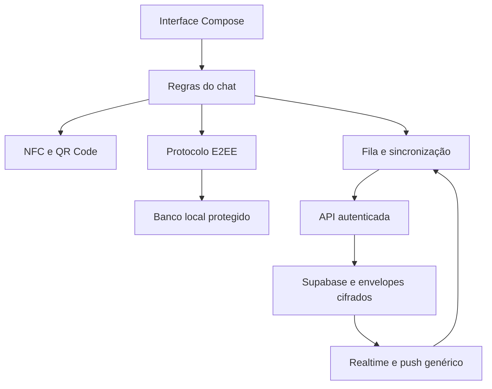
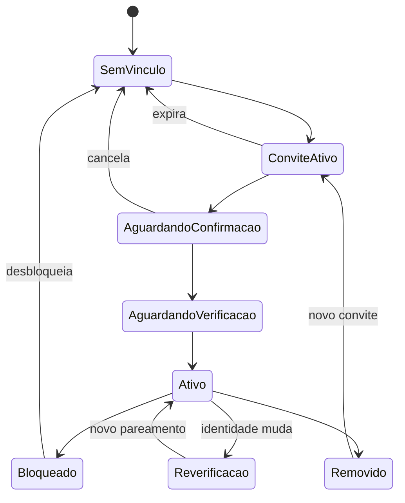

# ATLAS CHAT — Plano completo de criação e implantação

**Projeto:** Atlas — contatos presenciais e mensagens privadas entre usuários
**Responsável pelo produto:** Marco Aurélio da Cunha Prudente
**Versão do plano:** 1.0 — 15 de outubro de 2026
**Plataforma:** Android, Kotlin e Jetpack Compose
**Backend previsto:** Supabase Auth, PostgreSQL, funções transacionais, Edge Functions e Realtime
**Status:** arquitetura proposta para implementação; nenhum componente foi auditado ou implantado por este documento.

> Princípio: o Atlas facilita a conexão entre pessoas; o conteúdo das conversas permanece sob controle criptográfico dos participantes. O servidor entrega envelopes cifrados e não recebe as chaves necessárias para ler mensagens.

## 1. Objetivo e limites deste plano

Construir um módulo de chat integrado ao aplicativo Atlas, reutilizando a conta existente. Duas pessoas adicionam-se presencialmente por NFC ou QR Code, verificam suas identidades criptográficas e passam a conversar pela internet.

Este documento transforma a visão fornecida pelo responsável em requisitos, componentes, contratos, controles, testes e etapas de implantação. As decisões de produto abaixo são a linha de base proposta. Limites numéricos são parâmetros iniciais ajustáveis, não medições de desempenho.

Não houve acesso ao repositório, esquema Supabase ou código do Atlas Security. A existência e as propriedades desse módulo foram informadas pelo responsável; este plano não certifica sua implementação. Nenhuma versão de biblioteca é fixada sem prova de integração e revisão de licença.

### 1.1 Resultado do MVP

- Conta Atlas existente, sem novo cadastro independente.
- Um aparelho ativo para o chat por conta.
- Contatos próprios, sem acesso obrigatório à agenda Android.
- Pareamento presencial, consentimento bilateral e verificação de identidade.
- Conversas individuais de texto com E2EE.
- Histórico local protegido e fila de entrega remota temporária.
- Envio offline, reenvio idempotente, recebimento e confirmação E2EE.
- Bloqueio, remoção de contato, exclusão local e revogação de aparelho.
- Sem exportação nativa, leitura automática por IA ou backup comum do histórico.

### 1.2 Fora do MVP

Grupos, anexos, chamadas, stories, busca pública de usuários, status online, indicador de digitação, confirmação de leitura, múltiplos aparelhos, edição de mensagens, apagar para todos, transferência de histórico e recuperação criptográfica de backup.

O Atlas permanece no launcher do aparelho. Este módulo não depende de launcher próprio, ilha dinâmica ou overlay.

## 2. Registro das decisões arquiteturais

| ID | Decisão | Motivo / consequência |
| --- | --- | --- |
| ADR-01 | Reutilizar Supabase Auth existente | Uma conta; auditar o vínculo com o ID Atlas |
| ADR-02 | Um dispositivo ativo por conta | Reduz complexidade de sessões e distribuição de chaves |
| ADR-03 | Identidade criptográfica por dispositivo | Mudança de aparelho exige reverificação |
| ADR-04 | Sessões independentes com evolução de chaves | Evita chave permanente para todo o histórico |
| ADR-05 | Protocolo consolidado; biblioteca a validar | Não desenvolver algoritmos próprios |
| ADR-06 | NFC HCE/Reader Mode e QR equivalente | Compatibilidade deve ser comprovada em aparelhos reais |
| ADR-07 | Pareamento concluído online | Consumo único de convite e vínculo bilateral no servidor |
| ADR-08 | Histórico local e fila remota temporária | Servidor não funciona como backup de conversa |
| ADR-09 | Operações sensíveis por RPC transacional | Evita contornar regras com escritas diretas |
| ADR-10 | Realtime/push são sinalização | Banco e reconciliação garantem recuperação de pendências |
| ADR-11 | IA isolada do chat | Nenhuma incorporação automática à memória pessoal |
| ADR-12 | Recuperação de login sem recuperação do histórico | Perda do aparelho implica perda dos dados locais |
| ADR-13 | Dispositivo autorizado deve provar posse de credencial própria | JWT de conta não basta para alegar ser um aparelho |
| ADR-14 | Bloqueio verifica ambos os sentidos | Um bloqueio suspende comunicação do par |

### 2.1 Portões obrigatórios antes de produção

1. Auditoria da autenticação e do Atlas Security concluída.
2. Biblioteca criptográfica, licença, versão e manutenção aprovadas tecnicamente.
3. Verificação presencial resistente à substituição de identidade implementada.
4. Modelo de autorização por conta e aparelho validado.
5. Persistência transacional do estado criptográfico demonstrada.
6. Testes de acesso cruzado, replay, concorrência, revogação e recuperação aprovados.
7. Revisão independente da integração de segurança e correção dos achados críticos.

Se qualquer portão falhar, o lançamento é adiado; não há fallback para mensagens em texto aberto.

## 3. Requisitos funcionais e critérios de aceitação

| ID | Requisito | Critério |
| --- | --- | --- |
| RF-01 | Habilitar chat na conta existente | Não cria identidade de login paralela |
| RF-02 | Registrar aparelho | Apenas um dispositivo ativo por usuário |
| RF-03 | Criar convite presencial | Token imprevisível, uso único e expiração |
| RF-04 | Confirmar contato bilateralmente | Nenhuma conversa ativa antes das duas confirmações |
| RF-05 | Verificar identidade | Divergência do código impede ativação |
| RF-06 | Enviar texto | Conteúdo cifrado antes de sair do processo do app |
| RF-07 | Receber offline | Pendências são buscadas ao reconectar, dentro do prazo |
| RF-08 | Reenviar sem duplicar | Mesmo envio lógico mantém envelope e identificador |
| RF-09 | Confirmar entrega | Indicador depende de recibo E2EE validado |
| RF-10 | Remover contato | Suspende vínculo e exige novo pareamento |
| RF-11 | Bloquear | Servidor rejeita novos envios e convites do par |
| RF-12 | Excluir histórico | Apaga histórico local sem prometer apagar cópias alheias |
| RF-13 | Trocar aparelho | Revoga anterior e interrompe envio dos contatos até reverificação |
| RF-14 | Proteger histórico | Banco, estado de sessão e rascunhos cifrados em repouso |
| RF-15 | Negar acesso à IA | Serviços de memória/LLM não recebem mensagens por padrão |

Requisitos não funcionais: operações de rede fora da thread principal; consumo de bateria compatível com restrições Android; filas limitadas; formato versionado; acessibilidade; ausência de conteúdo sensível em telemetria; isolamento entre contas no mesmo aparelho.

## 4. Modelo de ameaças

### 4.1 Ativos

Conteúdo, histórico, identidades privadas, prekeys privadas, estados de ratchet, chave do banco, tokens de conta/aparelho, lista de contatos, convite presencial, metadados de comunicação e credenciais administrativas.

### 4.2 Ameaças e tratamentos

| Ameaça | Tratamento | Limite residual |
| --- | --- | --- |
| Leitura do banco Supabase | E2EE e ausência de segredos privados | Metadados permanecem visíveis |
| Servidor substitui chave pública | Identidades fixadas localmente e verificação presencial | Primeiro pareamento mal conferido continua vulnerável |
| Usuário altera destinatário/conversa | Vínculo autenticado no payload e validações de autorização | Servidor pode negar serviço |
| Repetição de mensagem | Deduplicação e regras do protocolo | Servidor ainda pode atrasar entrega |
| Roubo de JWT | Credencial de dispositivo e reautenticação para ações críticas | Conta invadida pode sofrer ações de indisponibilidade |
| Roubo do aparelho bloqueado | Keystore, bloqueio local e banco protegido | Depende do sistema e da configuração do aparelho |
| App/processo comprometido | Redução de superfície, atualização e revogação | E2EE não protege texto visível no endpoint comprometido |
| Convite fotografado/relay NFC | Expiração, uso único e conferência bilateral | NFC não prova distância contra relay sofisticado |
| Spam/negação de serviço | Consentimento, quotas e limites | Serviço depende de disponibilidade do backend |
| Extração por destinatário | Sem exportação e telas protegidas | Fotografia externa e cópia humana não são evitáveis |
| Histórico local comprometido | Criptografia local | Sigilo futuro do protocolo não apaga histórico já salvo |

Não prometer anonimato, apagamento remoto garantido, invulnerabilidade ou proteção pós-quântica completa apenas por usar um acordo de chaves específico.

## 5. Arquitetura geral e fronteiras de confiança



Texto aberto existe apenas no endpoint autorizado, durante composição, processamento e apresentação. O banco local guarda uma representação protegida. O backend recebe ciphertext e metadados explicitamente definidos.

A camada Atlas Security fornece primitivas de proteção local compatíveis, após auditoria. O protocolo de mensagens permanece encapsulado em adaptador próprio; não se deve acoplar sua sessão à chave de memória pessoal do assistente.

### 5.1 Módulos Android

| Módulo | Responsabilidades |
| --- | --- |
| `feature:chat-ui` | Telas, navegação, acessibilidade e estados de UI |
| `chat:domain` | Casos de uso, autorização local e regras de produto |
| `chat:pairing` | Formato do convite, HCE, Reader Mode, QR e verificação |
| `chat:crypto` | Adaptador da biblioteca, identidades e sessões |
| `chat:storage` | Persistência protegida e transações |
| `chat:sync` | Outbox, inbox, reconciliação e WorkManager |
| `chat:remote` | RPC, autenticação, Realtime e push |
| `chat:security` | Integração com Keystore, bloqueio e credenciais do aparelho |

Os nomes são propostas de organização; adaptar ao projeto existente. Não criar duplicações de Auth, cliente HTTP ou injeção de dependências sem necessidade.

## 6. Identidade, conta e aparelho

### 6.1 Identificadores

- `atlas_user_id`: identificador imutável da conta, vinculado ao sujeito autenticado.
- `device_id`: identificador aleatório da instalação autorizada.
- `device_epoch`: geração monotônica do aparelho ativo da conta.
- `conversation_id`: identificador da conversa lógica entre o par.
- `relationship_epoch`: geração da autorização entre os contatos.
- `session_id`: identificador lógico da sessão criptográfica, conforme adaptador.
- `client_message_id`: UUID aleatório por envio lógico.

Nome de exibição é mutável e não é evidência de identidade. Telefone é opcional, omitido por padrão e nunca necessário para criptografia.

### 6.2 Registro do dispositivo

1. Usuário autentica-se na conta Atlas e confirma habilitação do chat.
2. Aplicativo gera identidade criptográfica e material inicial de protocolo.
3. Gera credencial de autenticação do dispositivo separada das chaves de mensagem.
4. Servidor exige autenticação recente para registrar/substituir dispositivo.
5. Registra chaves públicas; mantém privadas somente no aparelho protegido.
6. Em uma transação, ativa nova geração e revoga a anterior, se houver.
7. Publica material de pré-chaves e habilita pareamento.

Não aceitar apenas um `device_id` fornecido no corpo. A sessão de API deve estar vinculada a uma credencial emitida após prova de posse do dispositivo. Usar mecanismo consolidado de desafio/resposta e assinatura suportada pelo Keystore, com nonce único, expiração e contexto autenticado; especificar e revisar o contrato antes da implementação. Não reutilizar chaves do Signal para assinar arbitrariamente requisições HTTP.

A validação deve chegar à função transacional por contexto confiável: ou credencial de dispositivo validada pelo gateway e chamada restrita, ou prova validada no servidor e vinculada a uma autorização curta. O cliente não pode chamar uma RPC alternativa que aceite uma alegação de dispositivo sem prova. Tokens de conta e dispositivo têm rotação e revogação separadas.

## 7. Protocolo criptográfico e escolha de biblioteca

### 7.1 Direção técnica

Avaliar PQXDH para estabelecimento assíncrono e Double Ratchet para evolução de chaves. A libsignal é candidata, não decisão já aprovada. O repositório informa uso externo sem suporte e APIs sujeitas a mudanças; licença AGPL-3.0 deve ser revisada quanto à distribuição pretendida. Não presumir que todas as combinações de especificação estão expostas da mesma forma em uma versão da biblioteca.

### 7.2 Prova de integração obrigatória

- Identificar coordenadas oficiais do pacote, versão, hash e origem.
- Demonstrar compilação para ABIs Android suportadas pelo Atlas.
- Confirmar API disponível para protocolo, serialização e armazenamento.
- Rodar vetores oficiais e interoperabilidade entre duas instalações.
- Validar inicialização com destinatário offline e prekeys consumidas.
- Validar mensagens fora de ordem, duplicadas e reinício do processo.
- Confirmar limites para chaves puladas e dados malformados.
- Estimar tamanho do APK, uso de memória, CPU e tempo de inicialização.
- Registrar estratégia de atualização, avisos de licença e manutenção.

Se a biblioteca não for adequada, avaliar outra implementação mantida e revisada, com ADR específico. Não substituir silenciosamente por AES com chave estática compartilhada.

### 7.3 Regras de sessão

- Identidade remota fixada localmente após verificação presencial.
- Material do servidor deve corresponder à identidade fixada.
- Alteração de identidade bloqueia envio; não usar aceite automático.
- Estado de ratchet atualizado atomicamente com envelopes e mensagens.
- Não reutilizar nonces ou construir primitivas fora da biblioteca.
- Não persistir chaves antigas além do necessário pelo protocolo.
- Limitar janela de mensagens fora de ordem e chaves puladas.
- Preservar versão do protocolo e rejeitar downgrade não autorizado.
- Falha de decriptação não reinicia sessão automaticamente.

Sigilo futuro depende de apagar segredos antigos adequadamente; recuperação após comprometimento depende de novas contribuições secretas e de o atacante perder acesso. Histórico salvo permanece protegido por sua criptografia local, não pelo descarte de chaves do transporte.

## 8. Pareamento NFC e QR Code

### 8.1 NFC

Um aparelho apresenta o convite por HCE (`HostApduService`); o outro usa Reader Mode e ISO-DEP para lê-lo. Definir AID do aplicativo sem colisão deliberada com pagamentos. Não usar Android Beam ou UID NFC como identidade.

O serviço HCE só entrega um convite quando o usuário tiver ativado explicitamente a janela de pareamento. Fora dessa janela retorna status sem dados. Exigir aparelho desbloqueado e testar o comportamento real conforme versão Android, Secure NFC e fabricante.

Definir comandos APDU de seleção, leitura de versão, comprimento e leitura fragmentada. Validar limites, truncamentos, tamanho máximo, timeout e cancelamento. Não transportar estado privado nem usar um protocolo de criptografia caseiro sobre NFC.

### 8.2 Cartão de convite

Campos mínimos: `format_version`, `invitation_id`, token aleatório de pelo menos 256 bits, `expires_at`, `atlas_user_id`, `device_id`, `device_epoch`, referência/fingerprint da identidade pública e nome de exibição mínimo.

Serialização determinística e limitada; QR usa o mesmo conteúdo lógico. Tamanho máximo inicial do cartão: 4 KiB, sujeito à prova de transporte. Telefone, se futuramente incluído, exige opção explícita e não deve ficar em log ou URL pública.

Token é segredo de uso único, não a chave da conversa. Servidor guarda seu hash. Tempo inicial de validade: cinco minutos, validado pelo relógio do servidor. Expiração no cliente melhora a experiência, mas não substitui a verificação remota.

### 8.3 Fluxo bilateral

1. A cria convite e apresenta NFC/QR.
2. B recebe, valida formato, validade e confirma intenção.
3. B autentica-se e resgata convite; a transação o vincula exclusivamente a B.
4. A vê a solicitação e confirma B.
5. Ambos obtêm as identidades públicas e verificam o código de segurança calculado localmente.
6. A representação de verificação incorpora identidades e contexto, segundo mecanismo estabelecido compatível com a biblioteca.
7. Ambos confirmam a comparação presencial.
8. Dispositivos fixam as identidades e o vínculo torna-se ativo.

Não implementar um código curto truncado arbitrariamente. Selecionar mecanismo de safety number/fingerprint estabelecido, avaliar entropia, apresentação, acessibilidade e confirmação. Um QR adicional de verificação pode transportar fingerprint completo.

Ao cancelar, expirar, mudar identidade ou detectar divergência: invalidar tentativa, não criar sessão utilizável e permitir começar com novo convite.

## 9. Máquinas de estado

### 9.1 Contato



Desbloquear não restaura automaticamente contato, sessão ou mensagens descartadas.

### 9.2 Mensagem

`LOCAL_PENDING → ENCRYPTED_QUEUED → SERVER_ACCEPTED → DELIVERED_VERIFIED`.

Estados auxiliares: `WAITING_NETWORK`, `WAITING_UNLOCK`, `RETRYABLE_ERROR`, `REJECTED`, `CANCELLED` e `DELIVERY_UNCONFIRMED`.

Distinguir expiração do envelope de ausência de recibo: se a mensagem chegou e o recibo se perdeu, não é correto afirmar que ela nunca foi entregue. A UI mostra "Entrega não confirmada" quando não houver prova suficiente. Só mostrar "Expirada sem entrega" quando existir evidência operacional apropriada, reconhecendo que o backend não é prova criptográfica de leitura.

## 10. Armazenamento local e bloqueio

### 10.1 Dados locais

| Entidade | Conteúdo |
| --- | --- |
| `LocalContact` | Nome, vínculo, identidade verificada e geração |
| `LocalConversation` | Identificador, ordenação e estado |
| `LocalMessage` | Texto, referências de resposta, estado e horário |
| `CryptoIdentity` | Segredos privados protegidos |
| `CryptoSession` | Estado serializado versionado do protocolo |
| `OutboundEnvelope` | Ciphertext imutável e metadados de reenvio |
| `InboundEnvelope` | Ciphertext pendente de processamento |
| `ProcessedEnvelope` | Identificador processado e resultado de deduplicação |
| `PendingReceipt` | Recibo a transmitir após persistência local |

Room pode organizar entidades; Room sozinho não cifra o banco. Escolher mecanismo mantido de criptografia de SQLite ou proteção por registros, avaliando busca, índices, WAL, migrações e licença. A escolha deve garantir uma única fronteira transacional para sessão e mensagens; evitar dois bancos sem atomicidade coordenada.

### 10.2 Hierarquia local

- Chave AES de proteção no Keystore, preferencialmente protegida por hardware quando disponível.
- Segredo aleatório do armazenamento cifrado por essa chave.
- Banco e material de protocolo protegidos por armazenamento criptografado.
- Credencial de dispositivo separada da chave de armazenamento.

As chaves internas do protocolo podem precisar entrar em memória; não alegar que todas permanecem dentro do Keystore. Minimizá-las na memória, evitar cópias, limpar buffers quando possível e reconhecer limites de JVM/GC.

### 10.3 Modo bloqueado

Decisão conservadora: histórico e sessões acessíveis somente após desbloqueio local. Em segundo plano, receber sinalização e, se autorizado pela credencial de dispositivo, armazenar apenas envelopes já cifrados em uma área de inbox. Descriptografia e recibo E2EE aguardam desbloqueio.

Isso implica que "Entregue" pode aparecer apenas depois de o destinatário desbloquear o chat. A UI deve explicar a semântica. A confirmação de transporte não substitui confirmação criptográfica.

Ao sair da conta: interromper workers, descartar tokens e fechar banco; oferecer aviso claro antes de destruir histórico. Nunca abrir banco da conta anterior na sessão seguinte.

## 11. Envelope e payload de mensagem

### 11.1 Envelope de transporte ilustrativo

```json
{
  "envelope_version": 1,
  "envelope_id": "uuid",
  "client_message_id": "uuid",
  "conversation_id": "uuid",
  "relationship_epoch": 1,
  "recipient_device_id": "uuid",
  "recipient_device_epoch": 1,
  "protocol_version": "versao-negociada",
  "ciphertext": "base64-do-envelope-da-biblioteca"
}
```

Remetente é derivado da autenticação e prova de aparelho. Campos externos são tratados como não confiáveis pelo receptor. Tipo de mensagem, texto, resposta e recibo ficam dentro do payload cifrado sempre que possível.

### 11.2 Payload interno ilustrativo

```json
{
  "payload_version": 1,
  "type": "text",
  "message_id": "uuid",
  "conversation_id": "uuid",
  "relationship_epoch": 1,
  "sender_device_id": "uuid",
  "recipient_device_id": "uuid",
  "sent_at": "ISO-8601",
  "text": "Mensagem",
  "reply_to_message_id": null
}
```

Conferir os campos internos contra a sessão autenticada e o contexto externo. Incluir contexto em associated data quando a API/protocolo permitir; caso contrário, vinculá-lo no payload autenticado e validar estritamente. Não alterar o protocolo padronizado para acomodar a aplicação.

Horário do remetente é informativo e não comprova entrega. Limites iniciais: texto até 8 KiB UTF-8; envelope até 64 KiB, validando overhead e bundles da biblioteca. Limites são independentes: mensagem curta não autoriza envelope arbitrariamente grande.

## 12. Envio, recebimento e consistência

### 12.1 Envio

1. Verificar vínculo ativo, identidade fixada, aparelho autorizado e conteúdo válido.
2. Criar intenção local com `client_message_id` e texto protegido.
3. Serializar operações da mesma sessão; impedir avanço concorrente.
4. Criptografar usando a biblioteca dentro da unidade transacional apropriada.
5. Persistir novo estado e envelope imutável na mesma transação.
6. Enviar com chave de idempotência.
7. Servidor valida conta, dispositivo, vínculo, épocas, bloqueio, quota e tamanho.
8. Persistir envelope e evento de notificação na mesma transação.
9. Cliente atualiza estado após resposta; timeout provoca reenvio do mesmo ciphertext.

Em conflito do mesmo identificador com ciphertext diferente, rejeitar, não sobrescrever. Backoff exponencial com jitter e teto; erros de identidade, bloqueio e revogação não entram em loop de retry.

### 12.2 Recebimento

1. Buscar pendências paginadas para o aparelho autorizado.
2. Persistir envelope cifrado de forma durável antes de confirmar transporte.
3. Se bloqueado localmente, aguardar desbloqueio.
4. Conferir contato, geração, destinatário e duplicação.
5. Descriptografar pela biblioteca e validar payload autenticado.
6. Persistir mensagem, estado atualizado e intenção de recibo na mesma transação.
7. Produzir recibo E2EE referenciando `message_id`.
8. Confirmar processamento ao servidor para liberar envelope.

Uma entrega de rede pode ocorrer várias vezes; o efeito local ocorre uma vez. Operações por sessão devem ser serializadas inclusive entre UI, worker e callback.

### 12.3 Recibos

Dois mecanismos distintos: ACK de transporte autoriza limpeza da fila; recibo E2EE comprova ao remetente que o endpoint validou e persistiu a mensagem. Recibos não geram outros recibos E2EE, evitando ciclos. Podem ser agrupados com limites definidos.

Para simplificar o MVP, conservar envelope remoto até processamento autenticado ou expiração; downloads repetidos são deduplicados. Se posteriormente houver remoção após mero download durável, documentar o risco de perder a única cópia pendente ao apagar os dados locais.

### 12.4 Ordenação e reconciliação

Servidor fornece cursor monotônico da fila, sem depender do relógio do cliente. Cursor não é prova de ordem causal. Exibição preserva ordenação local estável, horário informativo e vínculos de resposta.

Reconciliação ocorre ao abrir, reconectar, receber sinal ou concluir login. Não depender de um evento Realtime único. Após falha, buscar novamente pendências não confirmadas; não avançar cursor de forma que descarte registros ainda não processados.

## 13. Modelo de dados Supabase

Usar esquema isolado, como `atlas_chat`, sujeito à configuração de exposição da API. Reutilizar a identidade existente por chave estrangeira. Não executar SQL destrutivo sobre tabelas atuais.

| Tabela | Campos principais | Restrições |
| --- | --- | --- |
| `chat_devices` | id, user_id, epoch, identity_public, auth_public, status, created_at, revoked_at | Um ativo por usuário; geração única |
| `chat_prekeys` | device_id, key_id, kind, public_blob, signature, status, expires_at | Único por aparelho/tipo/id; apenas material público |
| `contact_invites` | id, creator_device_id, token_hash, expires_at, claimed_by, status | Token único; consumo atômico |
| `contact_relationships` | id, user_low, user_high, epoch, status, confirmations | Par canônico único; usuários distintos |
| `user_blocks` | blocker_id, blocked_id, created_at | Par direcionado único |
| `conversations` | id, relationship_id, status, created_at | Uma conversa lógica por vínculo no MVP |
| `conversation_members` | conversation_id, user_id | Exatamente dois membros por regra transacional |
| `message_envelopes` | id, message_id, sender_device_id, recipient_device_id, conversation_id, epochs, ciphertext, sequence, expires_at | Idempotência por aparelho/geração/message_id/destinatário |
| `push_installations` | id, device_id, token, provider, updated_at | Acesso restrito; token não público |
| `notification_jobs` | id, recipient_device_id, status, attempts, next_attempt_at | Fila interna sem conteúdo |
| `envelope_tombstones` | hash/id de idempotência, sender_device_id, expiry, resultado mínimo | Impede reinserção após remoção do envelope |

Tombstones são metadados de curta duração. Retenção inicial: 14 dias; cliente encerra retries em até sete dias. Uma geração encerrada não pode recriar envelopes antigos, mesmo após expirar tombstone.

Pré-chaves de uso único devem ser reservadas/consumidas atomicamente; tipos reutilizáveis seguem o protocolo. Evitar aplicar a mesma regra a todo material público. Considerar reserva vinculada ao solicitante e política de retry conforme biblioteca.

Índices mínimos: destinatário/sequência, expiração, aparelho ativo, par de contatos, bloqueios nos dois sentidos, jobs disponíveis e unicidade de idempotência. Medir antes de particionar tabelas.

## 14. Autorização, RLS e funções

### 14.1 Matriz de acesso

| Recurso | Cliente autorizado | Mutação |
| --- | --- | --- |
| Dispositivos próprios | Metadados próprios | Somente registro/revogação controlados |
| Identidade pública remota | Apenas descoberta autorizada por convite/contato | Nunca altera chave de terceiros |
| Prekeys | Bundle via operação validada | Consumo e publicação por operações específicas |
| Convites | Criador e participante vinculado | RPC com token e estado |
| Relação de contatos | Os dois participantes | RPC com transições permitidas |
| Bloqueios | Cada usuário vê seus bloqueios | Operação autenticada |
| Envelopes | Aparelho destinatário ativo | Envio/ACK por API restrita |
| Jobs e tokens push | Sem leitura pública | Somente serviço autorizado |

RLS habilitada em todas as tabelas expostas. Negar escritas diretas que permitam contornar validações. Se a identidade do dispositivo não puder ser expressa em claims confiáveis, não oferecer SELECT direto de envelopes só por `auth.uid()`; usar endpoint autenticado que valide aparelho.

### 14.2 Contratos de operação

| Operação | Validações e efeito atômico |
| --- | --- |
| `register_device` | Login recente, posse da chave, nova geração, revogação anterior |
| `create_contact_invite` | Aparelho ativo, limites, token com validade |
| `claim_contact_invite` | Token correto, válido, não consumido, ausência de bloqueio |
| `confirm_contact_relationship` | Participante correto, confirmação da geração atual |
| `claim_prekey_bundle` | Vínculo autorizado, identidade esperada, consumo único correto |
| `send_envelope` | Aparelho, par, épocas, bloqueio bilateral, limites e idempotência |
| `fetch_envelopes` | Aparelho destinatário ativo e paginação limitada |
| `ack_envelope` | Destinatário correto, limpeza e idempotência |
| `remove_contact` | Suspensão do par, nova época, descarte de pendências |
| `block_user` | Bloqueio, suspensão e cancelamento de convites/pendências |
| `revoke_device` | Reautenticação, revogação, tokens e jobs invalidados |

Envio e bloqueio devem compartilhar estratégia de locking sobre a relação, com ordem consistente. Testar interleavings: depois do commit do bloqueio, nenhum novo envio do par é aceito. Dados já baixados não podem ser recolhidos.

Preferir funções com privilégios mínimos. Quando `SECURITY DEFINER` for necessário, fixar `search_path`, qualificar objetos, restringir `EXECUTE` e validar identidade explicitamente. Segredos administrativos nunca vão para o APK. Edge Functions com credencial privilegiada não substituem essas verificações.

### 14.3 Erros de domínio

`AUTH_REQUIRED`, `DEVICE_REVOKED`, `PAIRING_EXPIRED`, `PAIRING_USED`, `CONTACT_NOT_ACTIVE`, `IDENTITY_CHANGED`, `RELATIONSHIP_VERSION_MISMATCH`, `RATE_LIMITED`, `PAYLOAD_TOO_LARGE`, `DUPLICATE_CONFLICT`, `UNSUPPORTED_VERSION` e `TEMPORARY_UNAVAILABLE`.

Não revelar a usuários não autorizados se uma conta específica os bloqueou. UI pode apresentar "Não foi possível enviar para este contato".

## 15. Realtime, push e execução em segundo plano

Realtime sinaliza disponibilidade; não é fila durável. Canais privados e permissões apropriadas são obrigatórios. Autorizações de canais podem permanecer em cache; revalidar bloqueio/aparelho a cada operação de busca/envio, independentemente do canal.

FCM é o candidato para notificações Android com Google Play Services. Usar payload genérico sem texto, nome, IDs de conversa ou chaves. Uma indicação opaca de sincronização é suficiente. Em aparelhos sem suporte, disponibilizar sincronização ao abrir e comunicar a limitação; suporte alternativo é fase futura.

Push de alta prioridade deve corresponder a notificação visível e respeitar as regras da plataforma; não garantir execução imediata. WorkManager coordena tarefas adiáveis e retries. Evitar manter foreground service ou WebSocket permanentemente para contornar economia de bateria.

Jobs de notificação são criados após persistência transacional do envelope. Worker envia, registra resultado mínimo, faz retry e remove tokens inválidos. Duplicação de push é tolerada; duplicação de mensagem é deduplicada.

Permissão de notificações é opcional: negá-la não impede chat aberto nem busca manual. Testar Doze, economia de bateria, force-stop, troca de rede e aparelho reiniciado.

## 16. Remoção, bloqueio e retenção

| Ação | Efeito local | Efeito remoto |
| --- | --- | --- |
| Excluir conversa | Apaga conteúdo e rascunhos locais | Não apaga cópia alheia; não remove contato |
| Remover contato | Suspende envio e mostra vínculo encerrado | Incrementa época e cancela pendências do par |
| Bloquear | Impede novas interações | Cancela convites e rejeita envios em ambos os sentidos |
| Desbloquear | Permite novo pareamento | Não restaura sessão/vínculo automaticamente |
| Revogar aparelho | Não garante limpeza física remota | Nega acesso futuro e cancela envelopes destinados à geração antiga |

Excluir histórico deve preservar o mínimo de estado criptográfico/deduplicação necessário enquanto o vínculo continuar ativo. Apagar sessão indiscriminadamente pode inutilizar mensagens futuras. UI distingue "Excluir histórico" de "Remover contato".

Política inicial: envelopes de texto e recibos pendentes até sete dias; convites ativos cinco minutos; tombstones 14 dias; jobs encerrados e logs operacionais por prazo curto definido no checklist operacional. Histórico local até exclusão pelo usuário. Não registrar conteúdo, tokens, bundles completos ou ciphertext em logs de diagnóstico.

DELETE no banco não implica eliminação imediata de backups, WAL e réplicas. Documentar retenção real do ambiente contratado e não anunciar apagamento físico instantâneo. Restauração do backend deve reaplicar revogações e tombstones disponíveis, evitando ressuscitar autorização antiga; em dúvida, suspender chat e exigir nova validação.

## 17. Recuperação, reinstalação e troca de aparelho

### 17.1 MVP sem backup do histórico

Recuperação de conta restaura login. Não restaura identidade privada, sessão ou mensagens. Ao reinstalar ou trocar aparelho, criar nova identidade, revogar a antiga e exigir novo pareamento com contatos.

Antes da ativação, apresentar: "As conversas ficam neste aparelho. Nesta versão, perder ou apagar os dados do Atlas pode tornar o histórico irrecuperável."

Revogação não apaga dados já disponíveis offline no aparelho anterior. Novo login não autoriza silenciosamente leitura de envelopes antigos.

### 17.2 Exclusões de backup

Excluir banco, WAL/SHM, segredos, estado de sessão, inbox/outbox e tokens das rotas de backup cloud e transferência entre aparelhos. Configurar regras compatíveis com as versões Android suportadas, incluindo `dataExtractionRules` e regras legadas quando aplicáveis. Testar restauração real; não confiar apenas em `allowBackup=false`.

### 17.3 Evolução futura

Transferência segura entre aparelhos ou backup E2EE exigirá ADR separado: segredo de recuperação, autenticação, revogação, proteção contra rollback, migração de estado e impacto sobre sigilo futuro. Não clonar estado de ratchet para dois aparelhos ativos.

## 18. Interface e experiência

### 18.1 Telas

1. Ativação: explicação breve de privacidade, histórico local e perda de acesso.
2. Conversas: lista, pesquisa local, novas mensagens e estados.
3. Contatos: adicionar, ver identidade, remover e bloquear.
4. Pareamento: escolher apresentar/receber, NFC e QR alternativo.
5. Conferência: nome, identidade e código de segurança acessível.
6. Chat: texto, resposta, envio/entrega e indicação de pendências.
7. Segurança do contato: fingerprint e data da verificação.
8. Aparelho: dispositivo ativo, revogação e consequência da troca.
9. Privacidade: bloqueio local, notificações e limites de cópia.

Textos de estado: "Aguardando conexão", "Desbloqueie para processar mensagens", "Identidade alterada: verifique novamente", "Entrega não confirmada". Não confundir "Enviada" com "Entregue" ou "Lida".

### 18.2 Redução de exportação

Sem botão compartilhar/exportar, providers de conteúdo ou encaminhamento externo; restringir copiar texto do histórico conforme requisito do produto. Aplicar proteção de janela em telas sensíveis, ocultar previews na tela de recentes, usar notificações genéricas e evitar URLs que contenham conteúdo.

Avaliar teclado, sugestões e acessibilidade sem prometer impedir captura por software privilegiado. Não desabilitar acessibilidade de forma indiscriminada. O destinatário continua capaz de fotografar ou transcrever o que vê.

## 19. Integração com IA e memória do Atlas

No MVP, o chat não é fonte de ingestão de memória, embeddings, resumo, observação de tela ou contexto do modelo. Serviços internos do Atlas devem respeitar uma marcação explícita de superfície privada e evitar capturar conteúdo do próprio chat.

Separar permissões, repositórios e interfaces. Se os módulos compartilham o mesmo processo/UID Android, esse isolamento é de arquitetura e política, não uma barreira equivalente a processos de segurança independentes. Testar os pontos reais de acesso.

Uma futura ação "Usar Atlas neste trecho" precisa de consentimento granular, definição de processamento local/nuvem e impacto sobre a regra de não exportar. Não incluir essa ação silenciosamente nesta versão.

## 20. Limites operacionais e prevenção de abuso

Parâmetros iniciais a validar: cinco convites ativos por conta, dez criações de convite por hora, 30 mensagens/minuto com burst controlado, texto de 8 KiB, envelope de 64 KiB, busca de até 100 envelopes por página e orçamento de fila por destinatário.

Valores não devem ser codificados em múltiplos lugares. Configuração server-side versionada, com limites conservadores no cliente. Definir quota máxima de bytes pendentes e recusa explícita quando esgotada; não descartar silenciosamente mensagens aceitas antes do prazo.

Sem moderação de texto no servidor, pois não há acesso ao conteúdo. MVP oferece bloqueio e controles de abuso por volume. Denúncia com conteúdo seria exportação voluntária e exige política e escopo separados.

## 21. Estratégia de testes

### 21.1 Matriz obrigatória

| ID | Cenário | Resultado esperado |
| --- | --- | --- |
| T-01 | Terceiro tenta ler envelope | Negado, sem metadados indevidos |
| T-02 | Conta correta, aparelho revogado | Busca/envio negados |
| T-03 | Cliente altera sender_id/device_id | Não assume identidade alheia |
| T-04 | Dois resgates simultâneos do convite | Apenas um vínculo confirmado |
| T-05 | Convite expirado ou QR alterado | Rejeição segura |
| T-06 | Servidor substitui identidade/prekey | Divergência detectada; envio bloqueado |
| T-07 | Mesmo envelope recebido repetidamente | Uma mensagem visível |
| T-08 | Mensagens fora de ordem | Processamento conforme janela do protocolo |
| T-09 | Ciphertext/header adulterado | Rejeitado sem corromper sessão |
| T-10 | Crash após criptografar e antes de enviar | Estado e envelope consistentes após reinício |
| T-11 | Crash após receber e antes de ACK | Reprocessamento idempotente |
| T-12 | Timeout após commit remoto | Retry retorna mesmo resultado |
| T-13 | Bloqueio concorrente com envio | Ordem transacional definida; nada novo após bloqueio |
| T-14 | Remover e readicionar contato | Envelopes da época anterior rejeitados |
| T-15 | Destinatário offline | Entrega ao reconectar dentro do prazo |
| T-16 | Recibo perdido | UI não afirma falsamente ausência de entrega |
| T-17 | Realtime/push indisponível | Reconciliação recupera pendências |
| T-18 | Dispositivo bloqueado | Sem plaintext; espera desbloqueio |
| T-19 | Troca/reinstalação | Sem recuperação indevida do histórico |
| T-20 | Backup/restauração do Android | Não restaura segredos/sessões do chat |
| T-21 | Conta A sai e conta B entra | Nenhum dado de A exposto |
| T-22 | Restauração antiga do servidor | Não reativa aparelho/relação revogados silenciosamente |
| T-23 | Limites e entradas malformadas | Erro controlado sem OOM ou loop |
| T-24 | Inspeção de logs e push | Sem mensagem, segredo ou token |
| T-25 | Atlas observa tela/memória | Conteúdo do chat não é ingerido |

### 21.2 Tipos de teste

Testes unitários de transições e validação; testes de contrato das RPCs; testes SQL de RLS com usuários distintos; testes instrumentados de Keystore/backup; testes de falha e concorrência; fuzzing do parser de convite/envelope; testes E2E com duas contas e aparelhos reais; revisão de dependências e análise de segurança.

Não testar criptografia apenas cifrando e decifrando com o mesmo código: usar vetores oficiais e cenários de adulteração. Não usar dados pessoais reais no ambiente de testes.

### 21.3 Matriz de aparelhos

Incluir aparelho principal do responsável e ao menos outro fabricante, NFC presente/ausente, HCE suportado/não suportado, Secure NFC ligado/desligado, versões Android mínima e recente suportadas, permissões negadas, pouca memória, disco cheio e relógio incorreto.

Metas iniciais de experiência em ambiente controlado: nenhuma duplicação visível nos testes de falha; envio em primeiro plano p95 inferior a três segundos em rede de teste estável; pareamento compreensível em menos de um minuto. Não são garantias de rede pública nem SLAs contratados.

## 22. Plano de execução por fases

### Fase 0 — Auditoria e decisões bloqueantes

Entregas: inventário de Auth/Security, modelo de ameaças, biblioteca candidata validada, política de histórico/backup, mapa de dados públicos e privados. Conferir logs, recuperação, chaves existentes, RLS, schemas, worker de notificações e observação de tela do Atlas.

Saída: ADRs aprovados tecnicamente e lista de incompatibilidades resolvida. Nenhuma migração destrutiva.

### Fase 1 — Provas técnicas

Executar três provas independentes: protocolo entre duas instalações com persistência; NFC HCE/Reader Mode e QR; API de dispositivo com revogação. Usar telas mínimas e dados descartáveis.

Saída: confirmação de viabilidade, versões fixadas e testes de reinício/falha passando.

### Fase 2 — Fundação Android e banco

Criar módulos, modelos, banco protegido, gerenciamento de credenciais, schema e RPCs mínimas. Configurar ambientes e CI. Implementar identidade por aparelho, migrações e exclusões de backup.

Saída: cadastro/revogação funcionando e isolamento entre contas comprovado.

### Fase 3 — Contatos e pareamento

Construir convite, consumo único, consentimento, verificação, armazenamento de identidade, remoção e bloqueio. Testar corridas e divergência de códigos.

Saída: apenas pares confirmados e verificados podem iniciar sessão.

### Fase 4 — Mensagens E2EE

Implementar sessão, outbox/inbox, texto, resposta, idempotência, entrega offline, recibos e histórico. Validar transações e concorrência entre workers.

Saída: duas pessoas conversam sem plaintext no backend; retries e crashes não corrompem sessão.

### Fase 5 — Operação e privacidade

Integrar push genérico, Realtime, reconciliação, retenção, quotas, telas protegidas e tratamento de troca de aparelho. Garantir exclusão do chat dos coletores da IA.

Saída: matriz de privacidade e segundo plano aprovada.

### Fase 6 — Segurança e beta fechado

Executar revisão independente, testes de carga e falha, correções, documentação operacional e treinamento do fluxo de recuperação. Liberar para pequeno grupo voluntário com aviso de ausência de backup.

Saída: nenhum achado crítico/alto sem resolução; indicadores estáveis no período definido.

### Fase 7 — Lançamento gradual

Liberar por coortes, acompanhar falhas, capacidade e suporte; manter possibilidade de interromper novos envios/pareamentos sem degradar criptografia. Expandir apenas após análise de cada coorte.

Não fixar prazo de calendário antes da auditoria e das provas. Para um desenvolvedor conciliando outro trabalho, executar fases sequencialmente com entregas pequenas e evitar adicionar grupos/anexos durante o MVP.

## 23. Backlog executável

| Item | Entrega | Depende de |
| --- | --- | --- |
| CHAT-001 | Auditoria Auth e Atlas Security | Acesso ao código |
| CHAT-002 | ADR do protocolo e licença | CHAT-001 |
| CHAT-003 | Prova E2EE com persistência | CHAT-002 |
| CHAT-004 | Prova NFC/QR | Formato preliminar |
| CHAT-005 | Credencial e revogação de aparelho | CHAT-001 |
| CHAT-006 | Banco local e migrações | CHAT-003 |
| CHAT-007 | Schema remoto e matriz RLS | CHAT-005 |
| CHAT-008 | Convites/consentimento/verificação | CHAT-004, 007 |
| CHAT-009 | Publicação e consumo de prekeys | CHAT-003, 007 |
| CHAT-010 | Outbox, envio e deduplicação | CHAT-006, 008, 009 |
| CHAT-011 | Inbox, decriptação e recibos | CHAT-010 |
| CHAT-012 | Telas e estados de mensagens | CHAT-011 |
| CHAT-013 | Bloqueio/remoção/épocas | CHAT-008, 011 |
| CHAT-014 | Push e reconciliação | CHAT-011 |
| CHAT-015 | Retenção, quotas e jobs | CHAT-007, 014 |
| CHAT-016 | Backup, telas e isolamento da IA | CHAT-006, 012 |
| CHAT-017 | Testes de falha e segurança | CHAT-013 a 016 |
| CHAT-018 | Revisão e beta | CHAT-017 |
| CHAT-019 | Implantação gradual e runbooks | CHAT-018 |

Cada item deve conter critério de aceitação, evidência de teste, migração aplicável e instrução de reversão. Não marcar "E2EE pronto" apenas porque uma mensagem cifrada apareceu no banco.

## 24. Ambientes, CI/CD e configuração

Separar desenvolvimento, homologação e produção, preferencialmente em projetos Supabase diferentes. Usar contas e chaves próprias de cada ambiente. Nunca copiar dados reais para testes.

Configuração pública: URL do projeto e chave publicável apropriada. Segredos de serviço, push e administração ficam no ambiente backend. Nenhum segredo em Git, APK, crash report ou arquivo de configuração distribuído.

Pipeline: lint/compilação → testes de domínio → migrações em banco limpo → testes RLS/RPC → testes de integração → build Android assinado → homologação em aparelhos → aprovação de critérios de release → coorte controlada.

Fixar versões de dependências, registrar inventário/SBOM, verificar origem de pacotes, manter assinatura do aplicativo protegida e documentar como atualizar a biblioteca criptográfica. Alterações no formato da sessão precisam de teste de migração e compatibilidade entre versões do app.

Migrações seguem expandir → migrar → validar → restringir → remover legado em release posterior. Não alterar o protocolo por feature flag durante sessão ativa sem negociação prevista. Backend rejeita clientes incompatíveis com mensagem de atualização, sem downgrade para texto aberto.

## 25. Procedimento de implantação

### 25.1 Antes da liberação

- Conferir revisões de segurança e licenças.
- Criar schema, constraints, índices, políticas e funções em homologação.
- Configurar credenciais de serviço, push, quotas e jobs de limpeza.
- Executar duas contas e dois aparelhos do cadastro até revogação.
- Validar que chamadas diretas não contornam o gateway.
- Simular indisponibilidade de Realtime/FCM e reconciliação.
- Verificar backup, retenção, logs e políticas de recuperação.
- Preparar avisos de produto e instruções de suporte sem coleta de mensagens.

### 25.2 Produção

1. Aplicar migrações aditivas com chat desabilitado para novos usuários.
2. Validar permissões e saúde dos jobs com contas de teste autorizadas.
3. Implantar funções compatíveis com a versão do app.
4. Distribuir versão Android para teste interno.
5. Habilitar pequena coorte e observar métricas.
6. Corrigir problemas antes de expandir para novas coortes.
7. Registrar versão do app, backend, schema e protocolo de cada liberação.

### 25.3 Rollback e suspensão

Em falha de autorização ou de criptografia, interromper novos pareamentos/envios afetados e preservar dados para correção, sem registrar conteúdo. Permitir acesso ao histórico local se seguro. Revogar credenciais comprometidas e informar usuários quando necessário.

Rollback do código não pode restaurar snapshots antigos de ratchet ou reutilizar estados de envio; isso pode quebrar garantias criptográficas. Preferir correção progressiva e migrações compatíveis. Não reinstalar biblioteca antiga sobre estado novo sem suporte comprovado.

## 26. Observabilidade, capacidade e suporte

Métricas: envelopes aceitos, rejeições por categoria, filas/bytes por faixa, tempo até ACK, retries, falhas de decriptação agregadas, divergências de identidade, jobs de push, consumo de prekeys e aparelhos revogados. Usar identificadores mínimos e acesso restrito; não criar perfil comportamental do conteúdo.

Alertas: aumento de falhas criptográficas, crescimento persistente de pendências, prekeys esgotadas, falha no job de retenção, violação de unicidade, picos de quota e falhas de autenticação de aparelho.

Custo aproximado deve ser calculado por usuários ativos × mensagens/dia × tamanho médio do envelope × retenção efetiva, acrescentando índices, recibos, retries, conexões Realtime, logs e backups. Não assumir que planos gratuitos suportam produção; medir em homologação e consultar preços ao contratar.

Suporte pede versão do app, código de erro e horário aproximado. Não solicita chave privada, token, exportação de conversa ou captura de mensagem. Diagnóstico voluntário deve ser sanitizado e revisável.

## 27. Runbooks essenciais

**NFC não conecta:** verificar suporte HCE/Reader, NFC ligado, desbloqueio e orientação; expirar tentativa e oferecer QR. Não insistir indefinidamente.

**Identidade mudou:** suspender envio, explicar mudança e orientar novo pareamento presencial. Não oferecer "confiar sempre" automático.

**Falha de decriptação:** guardar apenas envelope cifrado necessário, limitar retries e solicitar atualização/reverificação conforme diagnóstico. Não apagar histórico nem resetar sessão sem fluxo explícito.

**Aparelho perdido:** reautenticar conta por fluxo existente, revogar aparelho, registrar nova identidade e avisar sobre impossibilidade de recuperar histórico nesta versão.

**Fila acumulando:** verificar backend, jobs, quotas e conectividade; preservar mensagens dentro do prazo e informar atraso. Não mascarar pendência como entrega.

**Comprometimento de backend:** rotacionar credenciais administrativas, investigar metadados expostos, verificar substituição de identidades e suspender operações vulneráveis. E2EE não dispensa resposta ao incidente.

**Falha de armazenamento local:** não continuar enviando se não puder persistir estado e envelope atomicamente. Mostrar erro de espaço/armazenamento e retomar somente após integridade confirmada.

## 28. Riscos e mitigação

| Risco | Impacto | Mitigação |
| --- | --- | --- |
| Biblioteca/licença incompatível | Bloqueia produto | Resolver na Fase 0 antes de acoplar UI |
| NFC inconsistente entre marcas | Frustração no pareamento | QR equivalente e provas em hardware |
| Estado de sessão corrompido | Mensagens perdidas/inseguras | Transações e testes de crash |
| Confiança silenciosa em chave nova | Impersonação | Pinning e reverificação obrigatória |
| Credencial de conta basta para fingir aparelho | Revogação ineficaz | Prova de posse e autorização por dispositivo |
| IA ingere conversas | Quebra de privacidade | Exclusão explícita dos coletores e testes |
| Backup restaura sessão antiga | Rollback/reuso de estado | Exclusões e nova identidade na reinstalação |
| Usuário espera recuperar histórico | Perda inesperada | Aviso claro antes de habilitar |
| Escopo cresce para mensageiro completo | Atraso e manutenção | Texto individual até estabilidade |
| Servidor revela rede de contatos | Exposição de metadados | Minimização, controle de acesso e transparência |

## 29. Checklist final de aceite

- [ ] Conta existente reutilizada e mapeamento de IDs documentado.
- [ ] Um aparelho ativo e prova de posse realmente exigidos.
- [ ] Identidades privadas ausentes do backend.
- [ ] Biblioteca/protocolo/licença/versão registrados.
- [ ] Convite expira, é único e exige confirmação bilateral.
- [ ] NFC e QR verificam a mesma identidade.
- [ ] Mudança de chave interrompe envio.
- [ ] Texto cifrado antes da rede e persistência local protegida.
- [ ] Ratchet e filas sobrevivem a crash sem reutilização incorreta.
- [ ] RLS e API impedem acesso cruzado e bypass.
- [ ] Bloqueio/revogação valem além da interface e do Realtime.
- [ ] Recibo E2EE é distinto do ACK de transporte.
- [ ] Histórico não entra em backup, logs, push ou memória da IA.
- [ ] Expiração/retensão e limites estão configurados e monitorados.
- [ ] Recuperação de conta não restaura chaves antigas.
- [ ] Revisão de segurança concluída e achados relevantes corrigidos.
- [ ] Beta e procedimentos de suspensão/rollback validados.

## 30. Fontes oficiais e rastreabilidade

Documentação consultada para esta arquitetura em outubro de 2026. Revalidar APIs, versões e condições de uso no momento de implementar. As propostas de produto, limites e schema são decisões deste plano, não prescrições dos fornecedores.

1. Android NFC Reader Mode: https://developer.android.com/reference/android/nfc/NfcAdapter — interface de leitura e interação com HCE.
2. Android Host-based Card Emulation: https://developer.android.com/develop/connectivity/nfc/hce — HCE, APDU, bloqueio e limitações de UID.
3. Signal PQXDH: https://signal.org/docs/specifications/pqxdh/ — estabelecimento assíncrono de segredo compartilhado.
4. Signal Double Ratchet: https://signal.org/docs/specifications/doubleratchet/ — evolução de chaves e propriedades do protocolo.
5. libsignal: https://github.com/signalapp/libsignal — biblioteca candidata, licença e observações sobre suporte externo.
6. Android Keystore: https://developer.android.com/privacy-and-security/keystore — proteção e restrições de uso de chaves.
7. Supabase Realtime Authorization: https://supabase.com/docs/guides/realtime/authorization — autorização de canais e cache de permissões.
8. Android Auto Backup: https://developer.android.com/identity/data/autobackup — regras de backup e transferência entre aparelhos.
9. Firebase Message Types: https://firebase.google.com/docs/cloud-messaging/customize-messages/set-message-type — payloads e limites de confidencialidade do FCM.
10. Firebase Android Message Priority: https://firebase.google.com/docs/cloud-messaging/android-message-priority — prioridades, restrições de execução e trabalho em segundo plano.

## 31. Entregáveis esperados ao concluir o projeto

Código Android integrado ao Atlas; migrações e políticas Supabase versionadas; funções e jobs; contratos de API; inventário de dependências/licenças; testes automatizados e evidências em aparelhos; modelo de ameaças atualizado; revisão de segurança; instruções de operação/recuperação; versão beta; e registro de liberação gradual.

**Definição de pronto:** duas pessoas verificadas conseguem conversar, inclusive com falhas de rede e reinícios, sem o backend receber conteúdo aberto ou chaves privadas, com isolamento de contas, revogação efetiva, limites de privacidade compreensíveis e procedimentos de operação testados.
