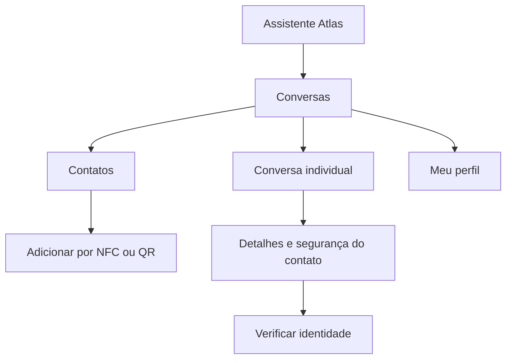

# ATLAS CHAT — Plano de perfil, avatar, interface e funcionalidades

**Projeto:** Atlas
**Responsável:** Marco Aurélio da Cunha Prudente
**Versão:** 1.0 — 15 de outubro de 2026
**Plataforma:** Android, Kotlin e Jetpack Compose
**Status:** especificação complementar para implementação; recursos não implementados por este documento.

## 1. Objetivo e relação com a arquitetura

Definir a experiência do Atlas Chat: perfil, avatar, navegação, telas, ferramentas, funcionalidades e integração com os controles de privacidade. Este documento complementa o plano técnico discutido na conversa; não substitui a seleção do protocolo criptográfico, a auditoria do Atlas Security ou a validação das políticas do backend.

A referência visual é a tela enviada pelo responsável: fundo quase preto, tipografia clara, destaque azul-lilás, cabeçalho com menu lateral e três pontos, saudação central e campo inferior "Pergunte ao Atlas…". Os valores visuais deste plano são propostas de implementação, não medidas extraídas do arquivo de imagem.

O objetivo do MVP é conversar individualmente por texto com contatos previamente aceitos e verificados. A conta Atlas é reutilizada. O chat possui suas próprias sessões criptográficas e mantém o conteúdo separado da memória do assistente.

### 1.1 Decisões de produto

- Acesso principal por ícone de conversas no cabeçalho do assistente.
- Acesso complementar pelo menu lateral.
- Nenhuma barra inferior permanente adicionada à tela principal.
- Perfil mínimo, avatar opcional e recado privado para contatos autorizados.
- Adição presencial por NFC ou QR Code, com confirmação bilateral.
- Histórico local protegido e entrega remota por envelopes cifrados.
- Sem presença online, visto por último ou confirmação de leitura.
- Sem anexos em mensagens, áudios, chamadas ou grupos no MVP.
- Sem leitura automática por IA, exportação ou encaminhamento externo.

### 1.2 Complementos técnicos necessários

O avatar é um recurso de perfil, mesmo com anexos de chat fora do MVP. Ele exige pipeline próprio de imagem, cifragem, distribuição e armazenamento. Perfil cifrado, sincronização de versões, busca local e silenciamento também precisam de implementação explícita.

## 2. Modelo de informações do usuário

| Campo | Regra | Visibilidade |
| --- | --- | --- |
| ID Atlas | Único, estável e vinculado à conta existente | Próprio usuário e contatos/convites autorizados |
| Nome de exibição | Obrigatório; entre 1 e 60 caracteres percebidos | Cartão de convite e contatos aceitos |
| Avatar | Foto opcional ou iniciais locais | Foto somente para contatos aceitos |
| Recado | Opcional; até 140 caracteres percebidos | Contatos aceitos |
| Telefone | Opcional e não identificador de segurança | Compartilhamento explícito por contato |
| Identidade de segurança | Fingerprint e data da verificação | Detalhes do contato |
| Versão do perfil | Inteiro monotônico por geração de aparelho | Controle interno |
| Geração do aparelho | Muda quando identidade é substituída | Controle interno e avisos de segurança |

Não criar diretório público de contas no MVP. "Público" no sentido criptográfico não significa disponível para qualquer visitante. O ID não é senha nem prova de identidade.

Validar nome e recado com suporte a Unicode e acentos. Limitar bytes além de caracteres para evitar entradas excessivas. Tratar controles invisíveis e de direção de texto de maneira segura, sem remover idiomas legítimos. Não renderizar HTML, comandos ou marcação executável.

Nome de exibição é informado pelo próprio contato e pode mudar. Manter ID e verificação acessíveis para reduzir confusão por nomes iguais. Mudança de nome ou foto não equivale a mudança de chave.

### 2.1 Perfil existente do Atlas

Auditar quais campos já estão disponíveis e quais são públicos. Não duplicar cadastro. O perfil privado do chat deve ser uma projeção explicitamente compartilhada, sem herdar automaticamente telefone, endereço, memórias ou dados do assistente.

Ao habilitar o chat, permitir reutilizar o nome e selecionar uma foto, com revisão antes de compartilhar. Se uma foto já tiver sido pública em outro módulo, cifrá-la agora não desfaz exposições anteriores.

## 3. Tela "Meu perfil no chat"

Acesso pelo menu de Conversas ou pelo perfil do Atlas, em uma seção própria.

Elementos:

1. Avatar grande com ação "Alterar foto".
2. Nome de exibição editável.
3. ID Atlas somente leitura, com ação explícita de copiar o identificador.
4. Recado editável e contador de caracteres.
5. Telefone opcional, com explicação de compartilhamento por contato.
6. Acesso a "Privacidade do chat".
7. Botão "Salvar alterações".

Copiar o próprio ID é permitido: não representa exportação do histórico. A restrição de cópia de mensagens não precisa impedir operações úteis sobre identificadores públicos autorizados.

Ao salvar, o aplicativo valida, persiste localmente e inicia distribuição cifrada aos contatos ativos. Mostrar "Perfil salvo" e, quando offline, "Atualizações serão compartilhadas ao conectar". Não afirmar que todos os contatos já receberam a mudança.

Cancelar descarta alterações ainda não salvas. Erro de upload mantém o avatar anterior e oferece tentar novamente.

## 4. Avatar: aparência e processamento

### 4.1 Aparência

| Contexto | Tamanho inicial proposto |
| --- | --- |
| Lista de conversas/contatos | 48 dp |
| Cabeçalho de conversa | 40 dp |
| Detalhes do contato | 96 dp |
| Edição do próprio perfil | 112 dp |

Formato circular; imagem recortada com preenchimento proporcional. Sem indicador verde de presença e sem selo que prometa segurança absoluta.

Sem foto, usar até duas iniciais e cor de uma paleta local discreta. A cor pode ser estável a partir do ID, mas não deve ser usada como código de verificação criptográfica. Nome vazio ou ilegível usa um ícone neutro.

### 4.2 Pipeline de imagem

1. Usuário escolhe imagem pelo seletor de fotos compatível com o aplicativo.
2. Aplicativo valida formato, tamanho e dimensões antes de decodificação completa.
3. Oferece recorte quadrado com prévia circular.
4. Reamostra para até 512 × 512 pixels.
5. Reencoda em formato estático aprovado, eliminando EXIF e demais metadados desnecessários.
6. Limita arquivo final a 256 KiB, como parâmetro inicial.
7. Cifra no aparelho antes de enviar ao backend.
8. Armazena no cache local protegido; não grava cópia aberta na galeria.

Entrada proposta: no máximo 10 MiB e 20 megapixels. Esses limites precisam de teste em aparelhos de pouca memória. Rejeitar animações no MVP e neutralizar arquivos malformados; não confiar apenas na extensão ou MIME informado.

Temporários ficam em área privada, são removidos após processamento e não entram em backup. Bibliotecas de imagem não devem deixar cache de disco em texto aberto. Se o renderizador não suportar cache protegido, desabilitar esse cache e usar o repositório cifrado do chat.

### 4.3 Remoção da foto

Gerar atualização de perfil com avatar ausente e versão maior. Remover cache próprio e distribuir a alteração aos contatos ativos. Contatos offline aplicarão quando sincronizarem.

Remover ou bloquear não apaga imagens que outra pessoa já recebeu, fotografou ou copiou. A interface não promete recolhimento remoto.

## 5. Distribuição privada de perfil e avatar

### 5.1 Conteúdo de perfil

Nome, recado, referência do avatar e telefone autorizado são enviados em mensagens de controle E2EE, usando as sessões verificadas existentes. Não são mensagens visíveis na linha do tempo e não aumentam o contador de conversas não lidas.

Payload lógico:

```json
{
  "type": "profile_update",
  "schema_version": 1,
  "device_epoch": 1,
  "profile_version": 4,
  "display_name": "Nome do contato",
  "about": "Recado opcional",
  "phone": null,
  "avatar": null
}
```

Os valores são ilustrativos. Uma referência de avatar inclui objeto opaco, versão, hash do ciphertext e material necessário para descriptografar, tudo dentro do payload E2EE. Metadados externos não devem revelar nome ou telefone.

Receber perfil não pode substituir silenciosamente a identidade criptográfica fixada. Rejeitar regressão de versão na mesma geração. Troca de aparelho exige reverificação antes de aceitar novos dados da identidade substituída.

### 5.2 Armazenamento do avatar

Proposta: bucket privado do Supabase Storage contendo somente bytes cifrados, com nomes aleatórios, sem ID legível ou nome de pessoa no caminho.

Cada nova versão de imagem usa chave de conteúdo aleatória e nonce corretos para uma implementação AEAD consolidada. A chave é distribuída somente nos envelopes E2EE dos contatos autorizados. Não reutilizar a chave das mensagens ou da memória do Atlas como chave do arquivo.

O mesmo objeto cifrado pode atender vários contatos, reduzindo uploads. Isso permite ao servidor observar acessos ao objeto; não há promessa de ocultação completa de relações. A chave da versão é compartilhada com os contatos autorizados, portanto um deles pode redistribuir a foto: esse limite é inerente ao compartilhamento.

Download passa por autorização do aparelho e vínculo ativo. Não disponibilizar URL pública. Para revogação imediata de novas buscas, preferir endpoint autenticado que verifique cada requisição; URLs assinadas já emitidas continuam válidas até expirar. Se usadas, manter validade curta e documentar esse limite.

### 5.3 Consistência e atualização

- Upload e publicação de perfil são operações distintas: só publicar referência após confirmar objeto íntegro.
- Manter avatar anterior até a nova versão estar disponível.
- Validar hash e autenticação antes de decodificar.
- Limpar uploads órfãos por job com período de tolerância.
- Conservar versão vigente enquanto houver referência autorizada.
- Evitar remover versões anteriores antes de resolver atualizações pendentes.
- Ao aceitar novo contato, transmitir snapshot atual, sem expor versões antigas.
- Ao bloquear, interromper novas atualizações e negar novas buscas pelo vínculo.

Como envelopes de transporte podem expirar, perfil precisa de ressincronização: ao reconectar, o app anuncia a versão conhecida por canal E2EE; o dono reenvia snapshot quando necessário. Um novo pareamento também solicita snapshot atual. Não depender para sempre de uma única notificação de atualização.

## 6. Navegação principal



### 6.1 Entrada na tela atual

Adicionar ícone de dois balões antes dos três pontos no canto superior direito. Área de toque mínima proposta de 48 dp. Descrição acessível: "Conversas" ou "Conversas, 3 não lidas".

O badge representa conversas com mensagens não lidas, não a soma de mensagens. Mostrar número até 99 e depois "99+". Não anunciar o conteúdo das mensagens na tela principal do assistente.

Manter a saudação, sugestões e campo "Pergunte ao Atlas…" existentes. Adicionar item "Conversas" ao menu lateral como caminho secundário.

### 6.2 Voltar e notificações

Voltar da lista retorna ao assistente. Voltar da conversa retorna à lista. Notificação abre o contexto autorizado após desbloqueio; dados externos não podem selecionar conta diferente ou contornar verificação.

Ao trocar de conta, limpar pilha de navegação e estado de UI. Conversas restauradas pelo sistema só são abertas após validar conta, aparelho e vínculo.

## 7. Tela "Conversas"

### 7.1 Componentes

| Área | Conteúdo |
| --- | --- |
| Cabeçalho | Voltar, título "Conversas", adicionar contato e menu |
| Busca | "Buscar contato ou conversa" |
| Lista | Avatar, nome, horário, resumo genérico e badge |
| Botão flutuante | Ícone de composição com ação "Nova conversa" |
| Menu | Meu perfil, contatos bloqueados e privacidade |

Prévia padrão: "Nova mensagem" ou "Conversa privada". Mostrar alertas úteis como "Envio pendente" e "Verificação necessária", sem conteúdo do texto. Não incluir opção de preview aberto no MVP para manter comportamento simples.

Ordenação pelo último evento de mensagem visível. Atualizações de avatar, recibos e sincronização não sobem a conversa na lista. Conversas sem mensagens podem ficar em seção ou ordem secundária por nome.

Busca desta tela filtra nomes dos contatos e conversas localmente. Não consulta um diretório público nem transmite o termo pesquisado.

### 7.2 Estados

- Vazio: "Adicione um contato para começar", com ações NFC e QR Code.
- Carregando: placeholders discretos, sem exibir dados da conta anterior.
- Offline: banner pequeno "Sem conexão. Mensagens serão enviadas quando possível".
- Bloqueado localmente: solicitar desbloqueio antes de revelar lista privada.
- Falha recuperável: botão tentar novamente sem apagar dados locais.
- Identidade alterada: indicador "Verificação necessária".

## 8. Contatos e nova conversa

Lista independente da agenda Android, com avatar, nome e estado do vínculo. Não exigir permissão de contatos.

Tocar em contato ativo abre conversa existente ou cria uma única conversa lógica. Toques rápidos ou chamadas simultâneas não devem duplicar conversas.

Contatos aguardando confirmação ficam em área separada; contatos com identidade alterada abrem orientação de reverificação. Bloqueados ficam em tela própria, não como destinatários disponíveis.

O fluxo "Novo contato" apresenta "Aproximar por NFC" e "Ler QR Code", além de "Mostrar meu QR Code". Explicar apresentar/receber com instruções curtas. Consentimento bilateral e comparação da identidade permanecem obrigatórios.

Ao concluir, oferecer "Iniciar conversa". Não enviar mensagem automática em nome do usuário.

## 9. Tela de conversa individual

### 9.1 Cabeçalho

Voltar, avatar, nome e menu de opções. Nome/avatar abrem detalhes. Um indicador discreto pode informar "Identidade verificada", desde que a verificação tenha ocorrido; não usar apenas um cadeado para afirmar que todo o sistema foi auditado.

Não exibir "online", "digitando…" ou "visto por último". Sem botão de ligação ou vídeo desabilitado decorativo.

### 9.2 Histórico

- Mensagens recebidas à esquerda, superfície cinza escura.
- Enviadas à direita, superfície azul-lilás escura com texto contrastante.
- Largura máxima sugerida de 82% da área útil.
- Horário e estado associados à mensagem, com descrição acessível.
- Separadores por data e marcador local de mensagens novas.
- Carregamento paginado ao subir no histórico.
- Não forçar rolagem ao final quando o usuário está lendo mensagens antigas.
- Exibir botão "Novas mensagens" para voltar ao final.

Texto é conteúdo inerte. No MVP, não buscar prévias de links nem carregar imagens remotas embutidas. A abertura de links, se futuramente introduzida, precisará de interação explícita e política própria; não pertence ao requisito de texto básico.

### 9.3 Campo de composição

Placeholder "Mensagem…", entrada multilinha com altura limitada e botão enviar. Sem clipe, câmera ou microfone nesta versão.

Enviar fica indisponível para texto vazio, identidade pendente, contato bloqueado ou dispositivo revogado. Offline permite fila local se a sessão e o vínculo estiverem válidos, com indicação de pendência. Falta de estado de sessão ou necessidade de verificar identidade impede envio offline.

Limite inicial: 8 KiB UTF-8, coerente com o envelope do chat. Ao exceder, explicar o limite sem truncar silenciosamente. Rascunho é local, cifrado e separado por conversa; não vai para SavedState, logs ou preferências abertas.

## 10. Estados de envio e leitura

| Estado interno | Texto/indicação ao usuário |
| --- | --- |
| Pendente local | Aguardando envio |
| Sem conexão | Aguardando conexão |
| Aceito pelo servidor | Enviada |
| Recibo E2EE válido | Entregue |
| Falha transitória | Tentando novamente |
| Falha definitiva | Não enviada — ver motivo |
| Ausência de confirmação | Entrega não confirmada |
| Identidade alterada | Verifique este contato para enviar |

Não usar "Lida". Entrar na tela pode zerar o contador local quando as mensagens estiverem efetivamente apresentadas, mas não envia evento de leitura à outra pessoa.

Estados de entrega não devem depender apenas da cor. Se o processamento criptográfico exigir desbloqueio, o recibo pode ser enviado somente após esse processamento; o texto de ajuda deve explicar que entrega não significa leitura humana.

## 11. Responder a uma mensagem

Pressionar a mensagem abre ações. "Responder" coloca uma referência acima do compositor com nome e trecho curto. Cancelar remove a referência, mantendo o texto digitado.

Enviar apenas `reply_to_message_id` dentro do payload cifrado; a prévia é resolvida no histórico local. Quando a mensagem original não existe, mostrar "Mensagem indisponível", sem recuperar texto de fonte externa.

Não persistir cópias desnecessárias do texto original em cada resposta. Se o conteúdo original for excluído localmente, a resposta continua válida, mas sua prévia fica indisponível. Referências devem pertencer à mesma conversa.

## 12. Menu de mensagem e exclusão local

Ações do MVP: "Responder" e "Excluir do meu histórico". Não incluir copiar, compartilhar, encaminhar, editar ou apagar para todos.

Ao excluir: confirmação curta "Esta mensagem será removida apenas deste aparelho". Apagar conteúdo local, índices de busca e referências de preview/cache, mantendo o mínimo de deduplicação necessário para impedir que uma repetição recrie a mensagem.

Não apagar estado de sessão criptográfica por causa da exclusão de uma mensagem. Preservar tombstone com identificador mínimo conforme retenção técnica.

Para mensagens pendentes, distinguir cancelamento de envio de exclusão do histórico. Só oferecer "Cancelar envio" se o estado permitir garantia de cancelamento antes do despacho. Em corrida com envio já iniciado, mostrar resultado real; excluir localmente não deve ser apresentado como cancelamento remoto.

## 13. Menu da conversa

| Ação | Efeito |
| --- | --- |
| Ver contato | Abre perfil e segurança |
| Buscar nesta conversa | Pesquisa local desbloqueada |
| Silenciar notificações | Suprime alertas daquela conversa neste aparelho |
| Excluir histórico | Remove conteúdo local, mantendo contato e estado técnico necessário |
| Remover contato | Encerra autorização e exige novo pareamento |
| Bloquear | Interrompe novas interações e atualizações de perfil |

Ações destrutivas ficam visualmente separadas. Silenciar é reversível e não avisa o outro participante. Arquivar e fixar conversas ficam para uma versão posterior.

## 14. Busca local

Busca interna permite pesquisar texto do histórico existente no aparelho, quando desbloqueado. Resultados mostram trecho curto, data e ação de ir à mensagem.

O mecanismo escolhido deve proteger também o índice: usar busca no banco cifrado ou índice cifrado no mesmo domínio de proteção. Não criar FTS em arquivo separado aberto. Termos de pesquisa não entram em analytics, logs, sugestões de teclado do app ou requisições de rede.

Excluir mensagem/histórico atualiza o índice na mesma unidade de persistência apropriada. Bloquear a tela remove resultados da UI e da memória de navegação. Busca não recupera mensagens que foram apagadas, expiraram antes da entrega ou estão em outro aparelho.

## 15. Silenciamento e notificações

Proposta de opções: uma hora, oito horas e até reativar. Armazenar preferência local protegida e respeitar todas as rotas de notificação: foreground, worker e push.

Notificação: título "Atlas" e texto "Você recebeu uma nova mensagem". Não mostrar avatar, nome, trecho ou ação de resposta direta na tela bloqueada.

Há uma consequência técnica: notificações exibidas automaticamente pelo provedor podem ignorar uma preferência mantida apenas no app. Escolher uma implementação coerente: sinalização processada pelo aplicativo antes de apresentar o alerta, respeitando restrições Android; ou preferência remota mínima com autorização. Para o MVP, priorizar decisão local e testar confiabilidade/limitações de background antes da liberação.

Silenciar não impede sincronização, não marca mensagens como lidas e não remove badges locais. Perder um push não perde a mensagem: abertura e reconexão executam reconciliação.

## 16. Detalhes do contato e segurança

Elementos: avatar, nome, ID Atlas, recado, telefone autorizado, data de adição, situação da verificação e ações de gerenciamento.

Separar dois conceitos:

- **Identidade verificada:** este aparelho conferiu a identidade criptográfica por pareamento.
- **Perfil recebido:** nome, foto e recado informados pelo contato.

"Verificar identidade" abre a representação do mecanismo escolhido na arquitetura, com explicação acessível e opção de novo pareamento. Não inventar código curto independente do protocolo.

Quando a identidade mudar, manter histórico protegido disponível localmente, destacar aviso e impedir novos envios até verificação. Não exibir nova foto/nome como prova suficiente para aceitar a chave.

Telefone não vira link de contato automático nem é gravado na agenda. Se houver ação de ligar no futuro, será recurso separado com autorização.

## 17. Privacidade, voz e integração com o assistente

Ao entrar em Conversas, Contatos privados ou em uma conversa individual:

1. Interromper reconhecimento de voz ativo e captura mãos-livres destinada ao assistente.
2. Interromper reprodução de resposta do assistente, evitando falar sobre a tela privada.
3. Suspender o wake word nessa área no MVP, para comportamento previsível.
4. Impedir captura da tela/texto por coletores internos de memória ou contexto.
5. Não compartilhar conteúdo com modelos locais/nuvem automaticamente.

Ao voltar ao assistente, restaurar somente a configuração que já estava habilitada, com indicação visível. Não iniciar gravação indiscriminada em background ou quando o app estiver bloqueado. Saída por notificação, troca de Activity e restauração após processo morto também precisam aplicar a política.

Se módulos compartilham o mesmo processo/UID, a separação é uma regra de arquitetura, não uma garantia de isolamento contra código comprometido. Centralizar o estado de superfície privada para evitar que cada coletor implemente uma interpretação diferente.

## 18. Sistema visual e acessibilidade

### 18.1 Tokens iniciais

| Token | Proposta |
| --- | --- |
| Fundo | `#101216` |
| Superfície | `#24242C` |
| Destaque | `#B1C4FF` |
| Texto principal | `#E5E7EE` |
| Texto secundário | `#B8BBC7` |
| Balão enviado | `#303B60` |
| Balão recebido | `#262831` |
| Espaçamento base | Múltiplos de 4 dp; margens usuais de 16 dp |
| Cantos | 16–24 dp conforme componente |

Validar contraste nas combinações reais, inclusive estados desabilitados. Cores são proposta, não certificação de acessibilidade.

Tipografia usa o sistema existente do Atlas e escala do usuário. Testar fontes ampliadas, nomes longos, idiomas RTL, modo paisagem e teclado aberto. Áreas interativas com pelo menos 48 dp; ícones com descrição; foco previsível; erros anunciados por leitor de tela.

Não identificar segurança, falha ou entrega apenas por cor. Animações curtas e dispensáveis, respeitando preferências de movimento. Evitar brilhos contínuos e efeitos que prejudiquem leitura.

## 19. Implementação em Compose e estado

Componentes propostos: `ChatEntryAction`, `ConversationListScreen`, `ConversationRow`, `ContactsScreen`, `ChatScreen`, `MessageBubble`, `ReplyComposer`, `MessageComposer`, `ContactDetailsScreen`, `ChatProfileScreen`, `AvatarEditor`, `IdentityVerificationScreen` e `ChatPrivacyScreen`.

ViewModels expõem estados imutáveis e eventos de UI. Repositórios controlam persistência, sessões e sincronização. Composables não acessam chaves, Supabase ou arquivos diretamente.

Representar explicitamente estados de bloqueio, conexão, vínculo e identidade. `isSending` isolado não descreve toda a operação. Usar identificadores estáveis para listas e paginação; evitar renderizar todo o histórico de uma vez.

Não persistir texto privado em estados de restauração não protegidos. Ao background/bloqueio, limpar seleções, busca e imagens decodificadas conforme política. Proteger janelas sensíveis e previews de recentes; testar comportamento em versões Android suportadas.

## 20. Ajustes de dados e contratos

### 20.1 Local

| Entidade | Campos novos sugeridos |
| --- | --- |
| Perfil próprio | nome, recado, telefone, versão e avatar protegido |
| Perfil remoto | snapshot autenticado, versão, geração e recebimento |
| Preferência de contato | autorização de telefone e personalizações futuras |
| Preferência de conversa | silenciamento e marcador local de leitura |
| Avatar local | referência cifrada, versão, hash e estado do download |
| Rascunho | texto cifrado, conversa e referência de resposta |
| Exclusão local | identificador mínimo para deduplicação |

### 20.2 Backend

Adicionar metadados de objetos de avatar e políticas de acesso por vínculo. Não adicionar colunas de nome/recado/telefone abertos apenas para facilitar telas. A informação pública mínima já usada em convites continua sujeita ao consentimento daquele fluxo.

Operações lógicas: preparar upload privado, confirmar objeto, publicar atualização E2EE, solicitar snapshot E2EE, autorizar download e remover objeto órfão. Escritas de Storage e autorização devem impedir leitura cruzada, substituição de arquivo e enumeração de caminhos.

Dados de silenciamento permanecem locais no caminho preferencial do MVP. Se a implementação exigir apoio remoto para supressão de push, registrar essa mudança como decisão explícita e guardar somente o mínimo necessário.

## 21. Fluxos de falha

| Situação | Comportamento |
| --- | --- |
| Avatar indisponível | Mostrar iniciais; manter conversa utilizável |
| Upload interrompido | Manter foto anterior e permitir retry idempotente |
| Imagem inválida | Rejeitar sem crash e sem publicar atualização |
| Perfil antigo recebido | Ignorar regressão na mesma geração |
| Contato bloqueado atualiza perfil | Rejeitar novas buscas/atualizações conforme vínculo |
| Busca com banco bloqueado | Solicitar desbloqueio, sem cache aberto |
| Perfil salvo offline | Persistir e indicar distribuição pendente |
| Mensagem excluída referenciada | Mostrar "Mensagem indisponível" |
| Mudança de conta | Limpar navegação e dados de UI anteriores |
| Voz ativa ao abrir chat | Parar captura antes de apresentar conteúdo |

## 22. Plano de testes e aceite

### 22.1 Interface

- Acesso pelo topo e pelo menu lateral leva à mesma área.
- Badge conta conversas não lidas e permanece consistente após reinício.
- Lista vazia e fluxo de novo contato são compreensíveis.
- Fonte grande e leitor de tela permitem todas as ações.
- Teclado não cobre compositor e mensagem mais recente.
- Nomes longos e fotos ausentes não quebram layout.
- Mudança de identidade impede envio sem esconder histórico local.
- Nenhuma ação de anexo/áudio aparece como funcional no MVP.

### 22.2 Privacidade e armazenamento

- Avatar sai do dispositivo já cifrado.
- EXIF e localização não aparecem no arquivo reencodado.
- Storage nega usuário/aparelho sem autorização.
- Bloqueio impede novas buscas, respeitando limite de cópias já recebidas.
- Cache de imagem, índice de busca e rascunhos não ficam abertos em disco.
- Termos de busca e conteúdo não entram em logs ou notificações.
- Telefone não é enviado sem consentimento por contato.
- Repetição não restaura mensagem excluída localmente.
- Foto removida não reaparece por atualização de versão inferior.
- Coletores do Atlas não leem nem memorizam a conversa.

### 22.3 Voz e notificações

- Abrir chat interrompe reconhecimento, wake word e reprodução conforme política.
- Voltar restaura apenas preferência anterior, sem iniciar gravação indevida.
- Silenciar suprime alertas em foreground e background.
- Notificação não revela nome, foto ou trecho na tela bloqueada.
- Negar notificação não impede chat nem sincronização ao abrir.
- Push perdido é recuperado pela reconciliação.

## 23. Etapas de implementação

| Fase | Entregas | Critério de saída |
| --- | --- | --- |
| 1 — Contratos | Campos, visibilidade, versões, silenciamento e política de voz | Regras sem ambiguidades |
| 2 — Navegação | Entrada, lista, contatos, detalhes e estados vazios | Fluxos navegáveis com dados de teste |
| 3 — Perfil | Edição, iniciais, recado e autorização de telefone | Persistência protegida e validações |
| 4 — Avatar privado | Recorte, reencode, cifragem, upload e cache | Sem imagem aberta no backend/cache |
| 5 — Conversa | Balões, compositor, resposta e estados | Integração com envio E2EE existente |
| 6 — Ferramentas | Busca, silenciamento e exclusão local | Índices e notificações consistentes |
| 7 — Privacidade | Voz, coletores, telas e troca de conta | Testes de isolamento aprovados |
| 8 — Validação | Acessibilidade, falhas, segurança e beta | Critérios de aceite cumpridos |

A interface pode ser desenvolvida com repositórios simulados enquanto a camada criptográfica é validada. A versão real não deve usar mensagens abertas como solução provisória de produção.

## 24. Backlog complementar

| ID | Item | Dependência |
| --- | --- | --- |
| UX-01 | Tokens e componentes compartilhados | Tema Atlas |
| UX-02 | Entrada no cabeçalho e badge | Contagem local |
| UX-03 | Lista e estados vazios | Repositório de conversas |
| UX-04 | Meu perfil e projeção privada | Mapeamento da conta |
| UX-05 | Seletor/recorte/reencode do avatar | Política de imagem |
| UX-06 | Avatar cifrado e autorização de download | Sessões E2EE e Storage |
| UX-07 | Atualização/snapshot de perfil | Versionamento e filas |
| UX-08 | Conversa e compositor | Serviço de mensagens |
| UX-09 | Respostas e exclusão local | IDs e deduplicação |
| UX-10 | Busca protegida | Banco e índice cifrados |
| UX-11 | Silenciamento real | Arquitetura de push |
| UX-12 | Detalhes/verificação/bloqueio | Relações e identidade |
| UX-13 | Política de voz e exclusão de coletores | Serviços do Atlas |
| UX-14 | Acessibilidade e testes de privacidade | UX-01 a UX-13 |

Cada item precisa de evidência de funcionamento e teste dos caminhos de falha, não apenas captura da tela final.

## 25. Implantação e evolução

Aplicar mudanças aditivas de dados, políticas de Storage e handlers de mensagens de controle antes de habilitar a UI. Clientes antigos devem ignorar tipos desconhecidos de forma segura conforme contrato, sem apresentá-los como texto; se isso não for possível, exigir atualização para habilitar perfil privado.

Liberar primeiro em homologação com duas contas e aparelhos reais. Testar usuário offline por tempo maior que a retenção de envelopes, atualização de avatar seguida de bloqueio e troca de aparelho. Distribuir para beta fechado antes da liberação ampla.

Em falha de avatar, desabilitar uploads novos e usar iniciais mantendo texto E2EE. Não fazer fallback para bucket público. Em falha de perfil, manter snapshot já validado e suspender atualizações. Em falha de privacidade/voz, bloquear a funcionalidade afetada até correção.

Evoluções futuras devem ser separadas: anexos, áudio, grupos, arquivo de conversas, leitura opcional, backups e ações explícitas de IA. Nenhuma entra no MVP apenas por reutilizar um botão de interface.

## 26. Checklist final

- [ ] Perfil mínimo definido, com visibilidade por campo.
- [ ] Avatar opcional, cifrado e sem metadados desnecessários.
- [ ] Telefone compartilhado somente por decisão explícita.
- [ ] Entrada no topo mantém o assistente como tela principal.
- [ ] Lista não revela conteúdo nas prévias padrão.
- [ ] Conversa distingue enviada, entregue e ausência de confirmação.
- [ ] Resposta, busca e exclusão operam apenas sobre dados autorizados.
- [ ] Silenciamento funciona em todas as rotas de alerta.
- [ ] Perfil recebido não substitui verificação de identidade.
- [ ] Banco, índice, rascunhos e cache permanecem protegidos.
- [ ] Voz e coletores são pausados/bloqueados na superfície privada.
- [ ] Mudanças de conta/aparelho não expõem dados anteriores.
- [ ] Interface acessível e validada em aparelhos reais.
- [ ] Limites de exclusão, bloqueio e cópias recebidas são comunicados.

**Resultado esperado:** uma experiência de chat consistente com o visual atual do Atlas, com perfil e avatar privados, navegação simples, conversas individuais de texto e ferramentas úteis que respeitam a arquitetura de segurança.
